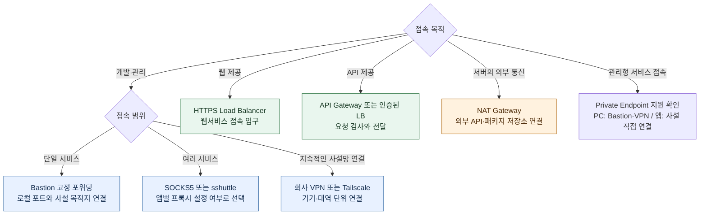

# OCI Secure Workflows

OCI 서버의 Public IP를 제거한 뒤에도 개발·관리와 웹/API 제공을 계속할 수 있도록 접속 방법, 셸 도구, 인프라 예제를 함께 제공합니다. ADB 같은 관리형 서비스의 사설 접속도 다룹니다. 내 PC의 관리 접속, 사용자용 서비스, 서버의 외부 통신을 구분해 선택합니다.

예를 들어 본인은 Bastion으로 SSH 개발을 하고, 동료에게는 Load Balancer의 HTTPS 데모 URL을 제공할 수 있습니다. 여러 사설 서비스를 오가거나 장시간 개발하는 경우에는 sshuttle·Tailscale·기존 회사 VPN도 검토할 수 있습니다. SOCKS5는 제공하는 방법 중 하나이며 필수는 아닙니다.

## 접속 방법 선택

처음이면 [도구 이름과 역할](docs/explanation/beginner-guide.md#도구-개요)부터 읽습니다. [여러 서버 동시 접속](docs/guides/multiple-targets.md) · [ADB·PaaS·SaaS 접속 범위](docs/guides/managed-services.md)

ADB SQL Worksheet는 [사설 HTTPS 접속](docs/guides/worksheet.md)을 따릅니다. 도메인을 유지한 고정 터널과 Chrome 연결 주소 매핑을 제공하며, 기존 점프 VM 경유로 실제 로그인 화면과 리소스 로딩을 확인했습니다.

**서버에 들어가서 작업하는 일**, **다른 사람에게 서비스를 제공하는 일**, **서버가 외부에 요청하는 일**을 먼저 구분합니다. 예를 들어 웹 화면 하나를 본인이 확인하는 상황과, 고객이 그 웹을 계속 이용하는 상황은 다른 경로를 사용합니다.



파란 상자는 본인의 관리 접속, 녹색 상자는 서비스 이용자의 접속, 주황 상자는 서버의 외부 통신을 뜻합니다. Cloudflare Tunnel와 Access는 **외부 중계 서비스 사용이 허용된 환경에서**, 로그인한 사용자에게 웹을 제공하는 또 다른 선택지입니다. 위 그림은 처음 검토할 방법을 고르는 안내이며 구성 전체를 자동 결정하지 않습니다. 이미 회사 VPN으로 대상 서버에 접근할 수 있다면 그 경로부터 확인합니다.

처음 배우는 분은 [접속 방식 입문 가이드](docs/explanation/beginner-guide.md)를 먼저 읽으십시오. 각 방법을 **적용 대상 → 선택 이유 → 구성 요소 → 실행 방법** 순서로 설명합니다. 용어를 알고 있다면 아래 비교표와 실행 절차로 바로 진행할 수 있습니다.

## 방법별 적용 대상

| 접속 목적 | 먼저 검토할 방법 | 접속할 때 달라지는 점 |
|---|---|---|
| 본인이 SSH·DB·RDP 또는 개발 웹 화면 몇 개 사용 | Bastion 고정 포트 포워딩 | 터널을 열고 `127.0.0.1:로컬포트`에 접속 |
| ADB SQL·APEX·Database Actions 사용 | Private Endpoint + Bastion 또는 VPN | SQL 포트와 웹 443 구분, TLS·wallet·DNS 준비 |
| 여러 사설 웹을 오가며 브라우저 프록시 설정 가능 | Bastion SOCKS5 | 브라우저에 중계 주소를 지정한 뒤 사설 URL 사용 |
| 여러 사설 TCP 서비스에 앱별 프록시 설정 없이 접근 | sshuttle | Bastion 뒤 Linux VM을 경유하도록 선택한 사설 대역 연결을 중계 |
| 여러 앱으로 장시간 개발·관리 | 기존 회사 VPN 또는 Tailscale | 연결된 사설망 주소 또는 Tailscale 주소 사용 |
| 동료·고객에게 웹서비스 URL 제공 | HTTPS Load Balancer | 사용자는 터널 없이 서비스 URL로 접속, 앱 인증 필요 |
| HTTP API에 토큰 검증·호출량 제한 적용 | API Gateway | API 입구에서 요청을 검사한 뒤 사설 백엔드로 전달 |
| 허용한 사용자에게 외부 중계를 통한 웹 접근 제공 | Cloudflare Tunnel와 Access | 서버의 외부 연결과 사용자 로그인 정책으로 웹 URL 제공 |

서버가 외부 API를 호출하거나 패키지를 내려받는 문제는 **NAT Gateway 같은 아웃바운드 경로**로 해결합니다. 위 표의 PC→서버 접속 방법과 통신 방향이 다릅니다. Public IP 제거만으로 모든 보안 정책이 충족되는 것은 아니므로 실제 정책과 finding을 확인해야 합니다.

처음에는 **고정 포워딩으로 본인의 접속 하나를 성공시키는 것**부터 권합니다. 서비스가 늘거나 연결 시간이 불편해지면 다른 방식을 선택합니다. [방법별 비교와 제약](docs/guides/alternatives.md) · [주소와 접속 원리 설명](docs/explanation/access-model.md)

## IGW·NAT 필요 조건

**사설 VM에서 Tailscale·Cloudflare Tunnel을 사용하거나 외부 API를 호출하는 경우, 인터넷 출구는 NAT Gateway로 구성할 수 있습니다. VM의 Public IP와 별도 Internet Gateway(IGW)는 필요하지 않습니다.** NAT 경로·DNS·필요한 외부 포트 허용·도구별 인증은 준비해야 합니다.

| 접속 구성 | IGW | NAT | 추가 조건 |
|---|---|---|---|
| 사설 VM의 Tailscale·Cloudflare Tunnel | **불필요** | **인터넷 출구로 사용 가능** | VM이 먼저 외부 연결 시작, 외부 서비스·포트 허용 |
| 사설 VM의 외부 API·패키지 다운로드 | **불필요** | **일반적인 구성** | 사설 서브넷의 `0.0.0.0/0 → NAT` 경로 |
| OCI 관리형 Bastion의 사설 대상 포워딩 | **불필요** | **그 접속을 위해서는 불필요** | 공식 생성 전제인 **Service Gateway와 경로**, 대상 포트 허용 |
| sshuttle로 사설 목적지 연결 | **경유 경로에 따라 결정** | **사설 목적지 연결 자체에는 불필요** | 관리형 Bastion 또는 점프 VM의 준비 조건 적용 |
| 인터넷에서 Public IP 점프 VM으로 직접 SSH | **필요** | **대체 불가** | 점프 VM의 Public IP·공용 서브넷·IGW 경로·SSH 허용 |
| VCN 내부 앱 → ADB Private Endpoint | **불필요** | **불필요** | 사설 경로·DNS·보안 규칙·DB 인증 |
| Service Gateway → 지원 OSN 서비스 | **불필요** | **불필요** | 지원 서비스·리전·SGW 경로·서비스 인증 |

**OCI NAT Gateway 뒤에 IGW를 추가 연결하는 구성은 필요하지 않습니다.** 반대로 NAT만으로 인터넷에서 VM에 직접 SSH 접속할 수는 없습니다. NAT는 VM이 시작한 연결과 응답을 처리합니다. 관리형 Bastion의 공용 접속 주소는 OCI가 제공하며, 고객 VCN에 IGW를 추가한다는 뜻이 아닙니다.

이 표는 **표시한 통신 경로 기준**입니다. 같은 VCN에서 공용 LB·공용 API Gateway 등 다른 공개 입구도 운영한다면 그 입구에 필요한 IGW는 별도로 유지합니다. 외부 API용 NAT와 관리형 Bastion용 Service Gateway도 서로 대체하지 않습니다. [IGW 공식 범위](https://docs.oracle.com/en-us/iaas/Content/Network/Tasks/managingIGs.htm) · [NAT 공식 범위](https://docs.oracle.com/en-us/iaas/Content/Network/Tasks/NATgateway.htm) · [Bastion 생성 전제](https://docs.oracle.com/en-us/iaas/Content/Bastion/Tasks/create-bastion.htm)

## 구성 순서

선택 후에는 **① 출발지·목적지·포트 확인 → ② 경로 구성 → ③ 방화벽·DNS 허용 → ④ TLS·로그인 설정 → ⑤ 실제 작업·차단·종료 확인** 순서로 진행합니다. 터널 실행만으로 접속 검증이 끝나지는 않습니다.

## 보안 효과와 조건

핵심은 **인터넷에서 서버·DB에 직접 연결할 수 있는 범위를 줄이고, 정해진 입구에서 접근자를 통제하는 것**입니다. 사설 IP만 사용해도 내부 경로가 과도하게 열려 있으면 위험은 남습니다.

| 구성 | 줄이는 위험 | 필요한 통제 |
|---|---|---|
| Public IP 제거·Private Endpoint | 인터넷의 직접 스캔·접속 시도에 노출되는 범위 | 기존 공개 경로 차단, 필요한 출발지·포트만 허용 |
| Bastion 고정 포워딩 | 상시 공개 SSH·DB 포트, 장기간 남는 임시 관리 접속 | OCI IAM·출구 IP allowlist·개인 키·목적지 제한·TTL |
| SOCKS5·sshuttle | 대상마다 공개 관리 포트를 여는 구성 | 중계 가능한 목적지가 넓어질 수 있으므로 NSG·계정 권한 최소화 |
| Tailscale | 관리 포트의 인터넷 직접 노출 | 사용자·기기·목적지별 접근 정책, 퇴사·분실 기기 회수 |
| Cloudflare Tunnel·Access | 원본 서버의 공개 인바운드와 익명 웹 접근 | Access 인증 필수, 원본 우회 경로 차단, backend 구간 TLS 검토 |
| LB·API Gateway | 여러 backend의 직접 노출, 분산된 접속 입구 | HTTPS·사용자/API 인증·요청 제한·backend 접근 제한 |

SSH 터널·VPN의 암호화 범위와 최종 서비스의 TLS 범위는 다릅니다. **DB·HTTPS의 인증서 검증과 앱 인증은 유지**합니다. 생성·접속 이벤트는 관련 감사 로그로 확인하고, SQL 실행·앱 요청 내역은 DB·앱 로그를 별도로 구성합니다. 터널만으로 모든 작업 내용이 기록되지는 않습니다. [상세 보안 기준](docs/explanation/security.md)

## 연결 흐름

아래 경로에서 화살표는 접속·요청의 흐름을 단순화한 것입니다. `사설 VM`은 인터넷에서 바로 접속할 수 있는 주소 없이 운영하는 클라우드 서버입니다. `127.0.0.1`은 그 주소를 입력한 PC 자신을 뜻합니다.

```text
고정 포워딩  PC의 localhost:8080 → Bastion → 사설 VM:8080
SOCKS5      프록시를 설정한 앱 → PC의 중계기 → Bastion → 앱이 요청한 사설 목적지
sshuttle    선택한 사설 대역으로 향하는 앱 연결 → SSH → Bastion 뒤 Linux VM → 목적지
Tailscale   PC 클라이언트 → 등록한 서버 또는 승인된 subnet router → 사설 서비스
웹서비스    사용자 브라우저 → HTTPS LB 또는 API Gateway → 사설 웹/API
Cloudflare  사용자 브라우저 → Cloudflare Access/Tunnel → cloudflared → 웹앱
외부 통신   사설 VM → NAT → 외부 API·패키지 저장소
```

Bastion은 별도 점프 VM을 운영하지 않고 제한된 시간 동안 접속하게 해 주는 OCI 서비스입니다. 고정 포워딩은 연결할 목적지를 미리 정하고, SOCKS5는 앱이 요청마다 목적지를 알려 줍니다. SOCKS5 중계 주소 `127.0.0.1:1080`은 **브라우저 프록시 설정에 넣는 주소**이며 주소창에는 실제 사설 서비스 URL을 입력합니다.

sshuttle도 이 저장소의 구성에서는 Bastion을 통과하므로 세션 최대 3시간 제약이 남습니다. Tailscale은 별도 클라이언트와 계정·접근 정책이 필요하고, Cloudflare Tunnel은 터널 외에 Access 로그인 정책과 DNS 설정이 필요합니다. 어느 방식도 기존 서비스의 로그인이나 네트워크 허용 규칙을 자동으로 대신하지 않습니다.

## 설치 없이 명령 미리보기

Git, Python 3.10 이상, POSIX 셸이 있으면 아래 예제를 실행할 수 있습니다. 외부 접속 클라이언트는 선택한 방법을 실제 실행할 때 준비합니다. 셸 예제는 macOS·Linux 계열 환경을 대상으로 하며 실제 검증 환경은 [검증 결과](docs/validation.md)에 있습니다.

```sh
git clone https://github.com/devmrko/oci-secure-workflows.git
cd oci-secure-workflows
sh scripts/workflow.sh
OCI_ACCESS_CONFIG=config/access.example.json sh scripts/workflow.sh list
OCI_ACCESS_CONFIG=config/access.example.json sh scripts/workflow.sh plan dev-web
```

도움말과 대상 목록이 나오고 계획에 `127.0.0.1:8080`과 `10.0.1.10:8080`이 표시되면 미리보기 성공입니다. 예제 설정은 실제 자원을 가리키지 않으며 이 단계는 OCI 조회·세션 생성·방화벽 변경을 하지 않습니다.

## 실제 접속 전에 준비할 것

| 방법 | 실행 위치와 준비물 |
|---|---|
| Bastion 고정 포워딩·SOCKS5 | PC에 OCI CLI 인증·SSH 키, OCI에 Bastion·접속 허용 CIDR·대상 방화벽 |
| sshuttle | PC에 sshuttle·로컬 방화벽 권한, Bastion 뒤 Linux VM에 Python 3.10 이상, VM에서 목적지 접근 |
| Tailscale | PC와 서버 또는 subnet router에 클라이언트·조직 로그인, 경로 승인·접근 정책 |
| Cloudflare | 웹앱에 도달하는 서버에 cloudflared, Dashboard 토큰 파일 또는 로컬 설정·credentials, 계정·도메인·Access 정책 |
| LB·API Gateway·NAT | Terraform 1.7 이상, OCI 프로파일·권한·기존 네트워크, 방법별 인증서·인증·라우팅 설정 |

예제와 도우미가 모든 인프라·계정·서비스 설치를 끝내 주는 것은 아닙니다. 외부 서비스의 사용 가능 여부와 요금도 확인합니다. 준비 항목과 설치 안내는 [방법별 쉬운 실행](docs/guides/easy-workflows.md)에 있습니다.

**Tailscale을 설치한 VM 자체에 Public IP가 필요한 것은 아닙니다.** 사설 VM이 NAT 같은 경로로 Tailscale 서비스에 필요한 외부 연결을 시작할 수 있어야 합니다. NAT Gateway에는 외부 통신용 Public IP가 있지만 VM에 직접 할당하는 것과는 다릅니다. NAT와 방화벽 특성에 따라 직접 UDP 연결 또는 암호화된 중계 연결을 사용하며, NAT를 만들었다는 사실만으로 직접 연결과 성능이 보장되지는 않습니다. [그림과 연결 조건](docs/explanation/beginner-guide.md#tailscale의-nat-연결-조건)

## 첫 실제 접속은 고정 포워딩으로

먼저 [Bastion 준비](docs/guides/bastion.md)를 완료하고 대상 서버에서 웹앱이 실행 중인지 확인합니다. 예제는 서버의 사설 IP에서 접근 가능한 8080 포트를 사용합니다. 기존 `config/access.json`이 없다면 아래처럼 복사하고, Bastion OCID·리전·키 경로와 `dev-web`의 서버 IP·포트를 실제 값으로 수정합니다.

```sh
cp config/access.example.json config/access.json
sh scripts/workflow.sh validate
sh scripts/workflow.sh doctor
sh scripts/workflow.sh plan dev-web
sh scripts/workflow.sh connect dev-web --execute
```

터널 터미널을 열어 둔 채 브라우저에서 `http://127.0.0.1:8080`을 엽니다. 대상 웹앱의 예상 화면이나 응답이 나오면 실제 접속 성공입니다. 브라우저 프록시 설정은 필요 없습니다. `doctor`는 로컬 도구와 파일만 확인하므로 성공했다고 네트워크 연결까지 검증된 것은 아닙니다.

SSH 개발은 `dev-ssh`, DB는 `dev-db`, RDP는 `dev-rdp` target을 실제 환경에 맞춰 사용합니다. 종료는 터널의 `Ctrl+C`이며 OCI 세션은 출력된 정리 명령으로 삭제하거나 TTL 만료를 기다립니다. [도구별 접속 주소와 종료 방법](docs/guides/clients.md)

## 다른 방법도 같은 셸에서 선택

아래는 **명령 미리보기**입니다. 실제 실행에는 `--execute`를 추가합니다. 준비와 성공 확인·종료·복구 절차를 읽고 사용합니다.

```sh
# 브라우저에 SOCKS5 프록시를 설정할 경우
sh scripts/workflow.sh connect seoul-socks
# 먼저 다른 터미널에서 dev-ssh 터널을 열어 두어야 합니다.
sh scripts/workflow.sh sshuttle dev-ssh --cidr 10.0.1.0/24
# 설치된 Tailscale의 상태 조회 명령 미리보기
sh scripts/workflow.sh tailscale status
# 로컬 named tunnel의 ingress 검사 명령 미리보기
sh scripts/workflow.sh cloudflare validate --config config/cloudflared.example.yml
```

- [SOCKS5 브라우저 따라하기](docs/guides/socks5-walkthrough.md): 중계 주소·DNS·원래 브라우저 설정으로 복구.
- [sshuttle 실행](docs/guides/easy-workflows.md#sshuttle): 두 터미널 순서, 사설 대역·DNS 범위와 방화벽 권한.
- [Tailscale 실행](docs/guides/easy-workflows.md#tailscale): 서버 직접 등록과 subnet router의 차이, 광고·승인·접근 정책.
- [Cloudflare 실행·검증](docs/guides/cloudflare.md): Dashboard 토큰 파일 실행, Access 로그인·익명 차단, 로컬 관리 방식과 구분.
- [기존 회사망 연결](docs/guides/alternatives.md#회사망-연결-요청에-필요한-정보): 회사 VPN에서 대상 VCN까지 도달하는지 확인.

`--execute` 없는 `connect`, `sshuttle`, `tailscale`, `cloudflare`는 외부 클라이언트를 실행하지 않습니다. 반면 `infra`의 init·validate·plan·show는 즉시 해당 Terraform 명령을 실행하며, apply는 저장된 계획과 스택 이름 확인 후 적용합니다.

## 여러 사용자용 웹과 서버 외부 통신

### Cloudflare Tunnel·Access 시험

| 준비물 | 확인 사항 |
|---|---|
| Cloudflare 계정·관리 도메인 | 기존 서비스와 겹치지 않는 테스트 하위 도메인 |
| Zero Trust·Access | 허용 사용자·로그인 방법 설정. **Free 가입도 카드 등록·한도 초과 과금 동의를 요구할 수 있으므로 가입 화면 확인** |
| 웹 서버와 cloudflared | cloudflared에서 backend 접근 가능. 첫 시험에는 업무 데이터가 없는 가상 응답 사용 |
| 외부 통신 | 사설 VM은 NAT 출구 사용 가능, VM Public IP·해당 서브넷의 IGW 경로 불필요. DNS와 TCP 7844(HTTP/2) 또는 UDP 7844(QUIC), 관리용 HTTPS 허용 |
| Dashboard 관리 터널 토큰 | 저장소 밖 파일에 보관, `chmod 600`. 토큰 값을 명령에 직접 넣지 않음 |

Dashboard에서 테스트 앱·허용 정책·DNS·터널을 준비하고 웹 서버를 실행한 뒤 다음 명령을 사용합니다. cloudflared 2026.11.1에서 확인했습니다.

```sh
chmod 600 "$HOME/.cloudflared/oci-demo.token"
# 미리보기 후 --execute를 추가해 실제 실행
sh scripts/workflow.sh cloudflare run \
  --token-file "$HOME/.cloudflared/oci-demo.token" --protocol http2
sh scripts/workflow.sh cloudflare run \
  --token-file "$HOME/.cloudflared/oci-demo.token" --protocol http2 --execute
```

**확인:** 익명 요청은 Access 로그인으로 이동하고, 허용 사용자는 로그인 후 원본 응답을 받아야 합니다. 위조 쿠키도 원본에 접근하지 못해야 합니다. **종료:** `Ctrl+C`로 커넥터·가상 웹을 종료하고 전용 앱·정책·터널·DNS·임시 토큰을 정리합니다. 시험에서는 이 셸 도우미와 실제 로그인을 확인했으며 **OCI NAT Gateway에 배치한 connector는 별도 검증 대상**입니다.

[가상 웹 준비 → Dashboard 구성 → 로그인·차단 시험 → 정리 전체 절차](docs/guides/cloudflare.md)

### OCI 웹·API 입구와 NAT

웹서비스의 공개 입구는 LB, API 요청 정책은 API Gateway, 서버 아웃바운드는 NAT 예제를 사용합니다. 필요한 것만 각각 선택하며 모두 설치할 필요는 없습니다. 각 Terraform 스택은 별도 state를 사용하고 기존 Compute의 Public IP나 기존 서브넷 경로를 자동 변경하지 않습니다.

```sh
cp terraform/load-balancer/terraform.example.tfvars terraform/load-balancer/terraform.tfvars
# 실제 값을 입력한 뒤 실행
sh scripts/workflow.sh infra load-balancer init
sh scripts/workflow.sh infra load-balancer validate
sh scripts/workflow.sh infra load-balancer plan
sh scripts/workflow.sh infra load-balancer show
```

plan은 OCI를 조회하고 로컬 계획을 만들지만 자원을 생성하지 않습니다. 인증서·백엔드 방화벽 연결·DNS·사용자 인증 등 후속 설정은 [인프라 구성](docs/guides/infrastructure.md)에서 확인합니다. 실제 Public IP 제거는 [전환과 복구 절차](docs/guides/migration.md)를 따릅니다.

## 검증 범위

| 범위 | 확인한 내용 | 추가 환경 검증 |
|---|---|---|
| 셸·Python 도우미 | 40개 테스트 통과, 미리보기·인자 전달·실패 처리·패키지 제외 규칙 | 환경별 계정·키·네트워크 연결 |
| ADB Worksheet | 기존 점프 VM의 고정 터널·SOCKS5 두 경로에서 실제 로그인 화면·TLS·리소스 로딩 확인 | 관리형 Bastion·VPN 경유, 로그인·SQL·SSO |
| sshuttle·OpenSSH | 실제 sshuttle 옵션 파서와 `ssh -G` 구성 해석 | sudo 방화벽 변경·원격 Python·사설 트래픽 |
| Cloudflare | 실제 named tunnel·Access 로그인 후 원본 응답, 익명·위조 쿠키 차단, 로컬 ingress 검사 | OCI NAT 경유·다른 사용자·IdP·성능. [실행·검증](docs/guides/cloudflare.md) |
| Tailscale | 대체 실행 파일로 셸 호출과 전달 인자 검사 | 실제 로그인·경로·접근 정책 |
| Terraform | 네 스택 validate와 8개 mock plan 테스트 통과 | 실제 plan/apply·서비스 동작·정책 finding 해소 |

```sh
sh scripts/test.sh
```

실제 클라이언트 도구가 없는 기본 테스트에서는 해당 옵션 검사가 skip될 수 있습니다. 40개 전체 검사와 실제 Worksheet·Cloudflare 접속의 범위·버전은 [검증 결과](docs/validation.md)에 있습니다. 한 경로의 성공이 다른 서비스·테넌시의 운영 검증을 대신하지는 않습니다.

## 상세 문서와 배포 파일

[그림으로 배우는 입문 가이드](docs/explanation/beginner-guide.md) · [주소와 접속 원리](docs/explanation/access-model.md) · [방법 비교](docs/guides/alternatives.md) · [셸 사용 절차](docs/guides/easy-workflows.md) · [명령과 설정 참조](docs/reference/commands.md) · [공식 출처](docs/reference/sources.md) · [설계](docs/design/secure-workflows.md) · [설계 결정](docs/adr/0001-access-paths.md)

`python3 scripts/package.py`를 실행하면 상위 디렉터리에 `oci-secure-workflows.zip`이 생성됩니다. 소스·문서·예제만 포함하며 실제 설정·키·Terraform state와 plan은 제외합니다. 외부 참고 코드는 복사하지 않았고, 이 저장소의 별도 재배포 라이선스는 아직 지정하지 않았습니다.
