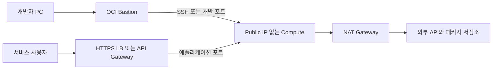

# OCI Secure Workflows

보안을 고려한 OCI 개발·운영 작업 방법과 실행 도구를 정리한 저장소입니다. 관리 접속과 서비스 공개를 분리하고, 필요한 접근 범위와 변경 내용을 확인하면서 작업하는 절차를 제공합니다.

현재는 Compute의 Public IP를 제거하면서 SSH 개발·관리와 웹/API 서비스를 계속 사용하는 방법을 다룹니다. 개발자는 Bastion으로 사설 주소에 접속하고, 서비스 사용자는 HTTPS 진입점으로 접근합니다. 저장소 이름은 `oci-secure-workflows`입니다.

## 무엇이 달라지나요

기존에 `http://서버공인IP:8080`으로 개발 화면을 열었다면, Public IP를 제거한 뒤에는 같은 주소로 들어갈 수 없습니다. 서버가 꺼진 것은 아닙니다. 인터넷에서 그 서버로 바로 들어가는 주소를 없앴으므로, 누가 어떤 목적으로 접속하는지에 맞춰 새 경로를 만들어야 합니다.

- **본인이 서버 한 곳에 SSH로 접속하거나 개발 화면 하나를 보려면:** Bastion의 고정 포트 포워딩을 사용합니다. 내 PC의 `127.0.0.1:8080`을 사설 서버의 `10.0.1.10:8080`에 연결해 두고 그 로컬 주소로 접속합니다.
- **본인이 여러 사설 서버의 웹 화면과 API를 오가려면:** Bastion의 SOCKS5를 사용합니다. 브라우저에 중계 주소를 한 번 지정하면 `http://10.0.1.10:8080`, `http://10.0.1.20:3000`처럼 대상 주소를 바꿔 접속할 수 있습니다. 각 요청의 목적지를 브라우저가 중계기에 알려 줍니다.
- **동료나 고객이 자기 브라우저에서 서비스 URL을 열어야 한다면:** LB나 API Gateway를 서비스 입구로 둡니다. 사용자마다 Bastion을 실행하게 하는 구성은 피하고, 서버는 사설 IP로 유지합니다.

**SOCKS5는 이 중 두 번째 상황을 위한 선택 기능입니다.** SSH만 사용하거나 개발 화면 하나만 필요하면 먼저 고정 포워딩부터 쓰셔도 됩니다. NAT는 별도로 서버가 외부 API나 패키지 저장소에 나갈 때 사용하는 경로입니다.

처음 보신다면 [접속 방식의 원리와 실제 사용 장면](docs/explanation/access-model.md)을 읽고, [SOCKS5로 사설 웹 화면 두 개 열기](docs/guides/socks5-walkthrough.md)를 따라가시면 됩니다.

## SOCKS5를 실제로 사용하는 순서

1. PC에서 Bastion SOCKS5 스크립트를 실행합니다. 내 PC에 `127.0.0.1:1080`이라는 중계 주소가 열립니다.
2. 브라우저의 **SOCKS5 프록시 설정**에 그 주소와 포트를 입력합니다. 스크립트 실행만으로 브라우저 설정이 바뀌지는 않습니다.
3. 주소창에 `http://10.0.1.10:8080`처럼 실제 사설 웹서비스 주소를 입력합니다. 요청은 브라우저 → 내 PC의 프록시 → Bastion → 사설 웹서비스 순서로 전달됩니다.
4. 다른 탭에서 `http://10.0.1.20:3000`을 열면 같은 터널로 다른 사설 서비스에 접속합니다. 대상마다 새 로컬 포트를 만들지 않아도 되는 것이 이 방식의 용도입니다.

**`127.0.0.1:1080`은 주소창에 입력할 웹페이지 주소가 아닙니다.** 브라우저가 중계 요청을 맡기는 주소입니다. 각 서비스의 로그인과 네트워크 접근 허용은 별도로 필요합니다. 종료할 때는 브라우저 프록시를 원래 값으로 되돌리고 터널을 종료합니다. 실제 설정 화면과 확인 명령은 [SOCKS5 따라하기](docs/guides/socks5-walkthrough.md)에 있습니다.

## 필요한 방법 선택

| 하려는 일 | 제공하는 방법 | 시작 문서 |
|---|---|---|
| SSH·VS Code·DB·RDP 접속 | Bastion 고정 포트 포워딩 CLI | [첫 접속](docs/guides/bastion.md) |
| 여러 사설 웹·서버 접근 | Bastion SOCKS5 CLI | [SOCKS5 활용](docs/guides/clients.md) |
| 프록시 설정 없이 여러 사설 서비스 접근 | sshuttle 실행 도우미 | [쉬운 실행](docs/guides/easy-workflows.md#sshuttle) |
| 장시간 개발 또는 사설망 연결 | Tailscale 실행 도우미·회사 VPN 절차 | [쉬운 실행](docs/guides/easy-workflows.md#tailscale) |
| 로그인한 사용자에게 웹 화면 제공 | Cloudflare named tunnel 실행 도우미 | [쉬운 실행](docs/guides/easy-workflows.md#cloudflare-tunnel) |
| 웹사이트·웹앱 상시 제공 | HTTPS Load Balancer Terraform | [인프라 구성](docs/guides/infrastructure.md#https-load-balancer) |
| JWT 인증·호출 제한이 필요한 API 제공 | API Gateway Terraform | [인프라 구성](docs/guides/infrastructure.md#api-gateway) |
| VM의 외부 API·패키지 다운로드 | NAT Gateway와 라우트 테이블 Terraform | [인프라 구성](docs/guides/infrastructure.md#nat-gateway) |
| 장시간 팀 개발·사설망 연결 | 회사망 VPN·FastConnect 검토 절차 | [대안 비교](docs/guides/alternatives.md) |



Python 도구는 로컬 PC에서 설치된 OCI CLI와 OpenSSH를 호출합니다. Terraform은 별도 명령으로 실행합니다. 기존 인벤토리·삭제 도구와 독립되어 있으며, Public IP 제거와 기존 서브넷 경로 전환은 [전환 절차](docs/guides/migration.md)에 따라 수행합니다.

## 먼저 미리보기

Python 3.10 이상만 있으면 아래 명령을 실행할 수 있습니다. 저장소의 상위 디렉터리에서 시작하고, 이후 명령은 저장소 루트에서 실행합니다.

```sh
git clone https://github.com/devmrko/oci-secure-workflows.git
cd oci-secure-workflows
python3 scripts/access.py --config config/access.example.json list
python3 scripts/access.py --config config/access.example.json plan dev-ssh
```

`127.0.0.1:2222 -> 10.0.1.10:22` 대상과 SSH 명령이 표시됩니다. 이 단계는 OCI 자격증명이나 SSH 키 없이 동작하며 네트워크 호출·세션 생성을 하지 않습니다. 예제 OCID와 IP는 실제 자원을 가리키지 않습니다.

## 실제 Bastion 연결

셸 명령으로 방법을 고르려면 [방법별 쉬운 실행](docs/guides/easy-workflows.md)을 사용합니다. 실제 계정 연결이 필요한 방법과 로컬에서 검증된 범위는 [검증 결과](docs/validation.md)에 구분했습니다.

```sh
# 예제 설정으로 대상 확인과 sshuttle 실행 계획 보기. 실제 연결 없음.
OCI_ACCESS_CONFIG=config/access.example.json sh scripts/workflow.sh list
OCI_ACCESS_CONFIG=config/access.example.json sh scripts/workflow.sh sshuttle dev-ssh --cidr 10.0.1.0/24
# 외부 도구가 설치되지 않아도 명령 미리보기는 가능합니다.
sh scripts/workflow.sh tailscale status
sh scripts/workflow.sh cloudflare validate --config config/cloudflared.example.yml
```

OCI CLI 인증, SSH 키 쌍, Bastion, 접속 허용 CIDR과 대상 방화벽 설정이 필요합니다. [준비 절차](docs/guides/bastion.md)를 먼저 완료합니다.

```sh
cp config/access.example.json config/access.json
# config/access.json의 리전·Bastion OCID·키 경로·대상을 편집합니다.
python3 scripts/access.py validate
python3 scripts/access.py doctor
python3 scripts/access.py connect dev-ssh --execute
```

터널 터미널을 열어 둔 상태에서 [SSH 설정](docs/guides/clients.md#ssh와-vs-code)을 사용합니다. 터널 종료 후 OCI 세션은 TTL까지 유지되며 화면에 표시된 명령으로 조기 삭제할 수 있습니다.

## 인프라 구성

Terraform 1.7 이상과 OCI provider 9.14.0을 사용합니다. `terraform/`의 네 스택은 각각 독립 실행합니다. LB·API Gateway 등은 과금될 수 있으며 권한·할당량·내부 허용 정책을 확인해야 합니다.

```sh
cp terraform/bastion/terraform.example.tfvars terraform/bastion/terraform.tfvars
# 실제 값을 입력한 뒤 실행합니다.
bash scripts/infra.sh bastion init
bash scripts/infra.sh bastion validate
bash scripts/infra.sh bastion plan
bash scripts/infra.sh bastion show
```

`plan`은 OCI를 조회하고 로컬 계획 파일을 작성하지만 자원을 생성하지 않습니다. 적용 명령과 VNIC NSG 연결 단계는 [인프라 구성](docs/guides/infrastructure.md)에 있습니다. 예제 파일을 그대로 적용하면 안 됩니다.

## 상세 안내

- [Bastion 준비와 실행](docs/guides/bastion.md)
- [방법별 셸 명령으로 쉽게 실행](docs/guides/easy-workflows.md)
- [접속 방식의 원리와 실제 사용 장면](docs/explanation/access-model.md)
- [SOCKS5로 사설 웹 화면 두 개 열기](docs/guides/socks5-walkthrough.md)
- [SSH·VS Code·브라우저·DB·RDP·kubectl](docs/guides/clients.md)
- [LB·API Gateway·NAT 구성](docs/guides/infrastructure.md)
- [이전과 복구](docs/guides/migration.md)
- [VPN·NLB 등 대안 선택](docs/guides/alternatives.md)
- [CLI와 설정 참조](docs/reference/commands.md)
- [참고 구현과 출처](docs/reference/sources.md)
- [설계](docs/design/secure-workflows.md) · [설계 결정](docs/adr/0001-access-paths.md) · [저장소 이름](docs/adr/0002-project-name.md) · [검증 결과](docs/validation.md)

소스와 예제만 묶으려면 `python3 scripts/package.py`를 실행합니다. 상위 디렉터리에 `oci-secure-workflows.zip`이 생성되고, ZIP 안의 최상위 폴더도 `oci-secure-workflows/`입니다. 실제 설정·키·Terraform state와 plan은 포함하지 않습니다.

현재는 로컬 검증을 마친 초기 도구입니다. 실제 테넌시의 plan/apply, 네트워크 연결과 Security Central finding 해소는 검증하지 않았습니다. 내부 정책을 충족하는지는 해당 자원의 finding과 적용 recipe로 확인해야 합니다.
