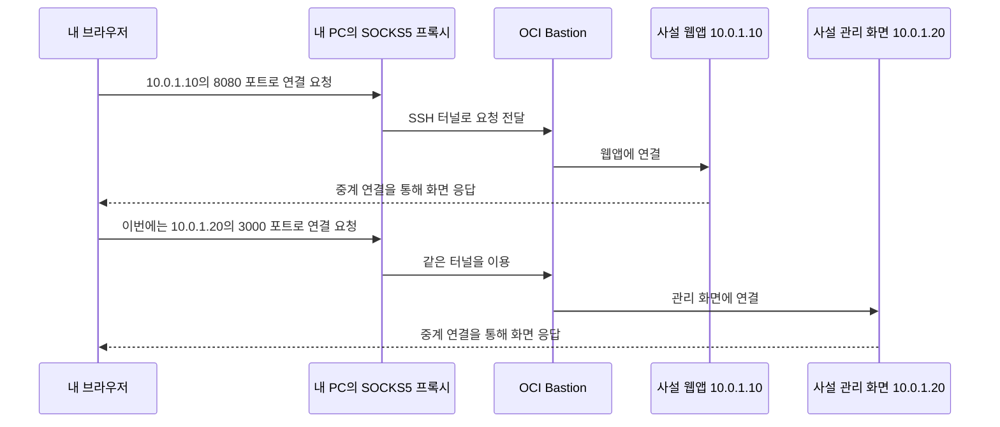

# Public IP 없이 개발하고 서비스를 제공하는 원리

이 구성의 목적은 서버로 들어가는 입구를 용도별로 정하는 것입니다. 본인이 잠깐 개발 서버에 들어가는 경우와 여러 사람이 계속 서비스를 이용하는 경우는 접속 방식이 다릅니다. 먼저 이 구분을 정하면 Bastion, SOCKS5, Load Balancer 중 무엇을 써야 할지 판단하기 쉽습니다.

## Public IP를 없애면 왜 접속이 끊기나요

예를 들어 개발 VM이 다음 주소를 가지고 있다고 가정합니다. 주소와 서비스는 설명용 예시이며 실제 환경과 무관합니다.

| 항목 | 주소 | 사용 위치 |
|---|---|---|
| VM Public IP | `203.0.113.50` | 인터넷에서 VM으로 접속할 때 사용하던 주소 |
| VM Private IP | `10.0.1.10` | OCI의 사설 네트워크 안에서 사용하는 주소 |
| 개발 웹앱 | TCP `8080` | 해당 VM에서 실행 중인 웹 서비스의 포트 |

원래는 PC에서 `http://203.0.113.50:8080`을 열었습니다. Public IP를 제거하면 이 입구가 사라집니다. 사설 주소 `http://10.0.1.10:8080`은 남지만, 일반적인 집·회사 인터넷 연결만으로는 그 주소까지 갈 경로가 없습니다. 회사 VPN 등이 이미 해당 VCN까지 연결되어 있다면 예외적으로 직접 접속할 수도 있습니다.

이때 필요한 것은 PC에서 OCI 사설 네트워크 안쪽으로 요청을 전달할 수 있는 경로입니다. Bastion은 허용된 사용자가 제한된 시간 동안 이런 접속을 할 수 있도록 하는 OCI 관리형 서비스입니다. 별도 Linux 점프 서버를 만드는 것과는 운영 방식이 다릅니다.

## 고정 포트 포워딩은 한 목적지를 미리 정합니다

웹앱 하나만 보려는 경우를 생각해 보겠습니다.

```text
내 브라우저에서 http://127.0.0.1:8080 열기
        ↓
내 PC의 SSH 터널이 요청을 받음
        ↓  Bastion을 경유
OCI VM의 10.0.1.10:8080으로 전달
        ↓
웹앱 응답이 같은 연결을 통해 브라우저로 돌아옴
```

`127.0.0.1`은 **현재 사용하는 PC 자신**을 가리킵니다. 이 주소가 VM 주소로 바뀌는 것이 아니라, PC에서 실행한 SSH가 로컬 포트를 받아 미리 정한 VM 포트로 전달하는 것입니다. 따라서 브라우저에는 별도 프록시 설정이 필요 없습니다.

SSH를 쓸 때도 같습니다. `내 PC:2222 → VM:22`를 연결하면 SSH 클라이언트가 `127.0.0.1:2222`에 접속합니다. 다른 VM이나 다른 포트가 필요하면 그 목적지에 맞는 포워딩을 추가합니다. 이 패키지는 target별로 한 터널을 실행합니다.

이 방식은 SSH, DB 클라이언트, RDP처럼 접속 대상이 명확한 도구에서 시작하기 쉽습니다. 실제 명령은 [개발 도구별 접속](../guides/clients.md)에 있습니다.

## SOCKS5는 요청마다 목적지를 알려 주는 중계 방식입니다

이번에는 관리할 서비스가 세 개라고 가정하겠습니다.

| 서비스 | 사설 주소 | 하려는 일 |
|---|---|---|
| 개발 웹앱 | `http://10.0.1.10:8080` | 화면과 기능 확인 |
| 별도 관리 화면 | `http://10.0.1.20:3000` | 상태·로그 확인 |
| 사설 API | `http://10.0.1.30:8000/health` | API 응답 확인 |

고정 포워딩이면 각 목적지에 맞는 로컬 포트를 정합니다. SOCKS5를 사용하면 내 PC에 **하나의 중계 접수처 `127.0.0.1:1080`**를 만들고, 앱이 연결할 때마다 원하는 주소와 포트를 전달합니다.



브라우저 주소창에는 계속 **실제 접속할 사설 서비스 주소**를 입력합니다. `1080`은 웹 화면이 뜨는 포트가 아니라 브라우저가 중계 요청을 보내는 포트입니다. SOCKS5는 특정 웹앱의 이름이 아니라 이 요청을 주고받는 규약의 이름입니다.

스크립트만 실행한다고 모든 앱의 접속이 바뀌지는 않습니다. 브라우저에는 SOCKS 프록시 설정을, curl에는 `--proxy` 옵션을 지정해야 합니다. 프록시를 설정하지 않은 앱은 원래 네트워크 경로를 그대로 사용합니다. OS 전체 프록시 설정으로 바꾸는 것도 이 도구가 자동으로 수행하지 않습니다.

도달할 수 있는 대상은 Bastion의 지원 범위와 네트워크·방화벽 규칙 안으로 제한됩니다. 이 패키지는 TCP 연결을 사용하며 ping 같은 ICMP나 UDP 전체를 사설망으로 전달하는 VPN 기능을 제공하지 않습니다. [OCI 세션 종류](https://docs.oracle.com/en-us/iaas/Content/Bastion/Concepts/bastionoverview.htm)

## 두 방식은 사용자가 입력하는 주소도 다릅니다

| 항목 | 고정 포워딩 | SOCKS5 |
|---|---|---|
| 연결 목적지 결정 | 터널 생성 전에 VM IP와 포트를 정함 | 앱이 접속할 때마다 목적지를 전달 |
| 브라우저 설정 | 프록시 설정 불필요 | SOCKS5 프록시 설정 필요 |
| 주소창 입력 예 | `http://127.0.0.1:8080` | `http://10.0.1.10:8080` |
| 다른 서비스로 이동 | 해당 목적지용 포워딩 추가 | 도달 가능한 사설 URL로 이동 |
| 프록시를 지원하지 않는 앱 | 로컬 주소로 연결할 수 있으면 사용하기 쉬움 | 추가 중계가 필요할 수 있음 |
| 먼저 선택할 상황 | SSH 또는 웹 화면 하나 | 여러 사설 웹·API를 번갈아 이용 |

SOCKS5를 써도 웹 로그인·DB 비밀번호·VM SSH 키가 없어지는 것은 아닙니다. Bastion을 통과할 권한과 대상 서비스 자체의 인증은 각각 필요합니다.

## 사설 도메인은 DNS도 안쪽에서 조회해야 할 수 있습니다

서비스가 `http://app.dev.internal:8080` 같은 이름을 사용한다면 먼저 그 이름에 대응하는 IP를 알아야 합니다. 이 이름 조회를 DNS라고 합니다. PC의 일반 DNS가 OCI의 내부 이름을 모르면 프록시 연결 전에 이름 조회부터 실패할 수 있습니다.

SOCKS를 통한 DNS 조회를 켜면 이름을 중계 경로에 전달해 조회하도록 할 수 있습니다. 해당 이름이 VCN에서 실제로 해석되는지는 별도로 확인해야 합니다. curl의 `socks5h://`는 프록시 쪽에서 이름을 해석하도록 요청합니다. 프록시를 거쳐도 HTTPS 인증서의 도메인 검증은 유지합니다. [curl 프록시 옵션](https://curl.se/docs/manpage.html)

## 고객이나 동료가 계속 쓸 서비스는 어디로 연결하나요

본인만 개발 화면을 보는 동안에는 Bastion이 편합니다. 그러나 다른 사용자가 접속할 때마다 OCI 권한·키·터널·브라우저 프록시를 설정해야 한다면 일반 웹서비스로 사용하기 어렵습니다. Bastion 세션 만료도 서비스 연결에 영향을 줍니다.

일반 사용자에게는 LB 또는 API Gateway의 HTTPS 주소를 제공합니다.

```text
사용자 브라우저 → https://app.example.com → Public LB → 사설 VM의 웹앱
API 호출 프로그램 → HTTPS API 주소 → API Gateway → 사설 VM의 API
```

**Load Balancer는 웹서비스의 입구**입니다. 사용자는 평소처럼 URL을 열고, LB는 내부 서버로 전달합니다. 서버가 한 대여도 공개 입구를 분리하는 용도로 사용할 수 있습니다. 앱 로그인은 계속 필요합니다.

**API Gateway는 API 요청을 검사하고 전달하는 입구**입니다. 예를 들어 토큰이 유효한지 확인하고, 특정 경로·메서드만 연결하고, 호출량을 제한할 수 있습니다. 일반 웹앱과 API를 함께 제공하고 앱이 인증을 이미 처리한다면 LB부터 검토하시면 됩니다. 둘을 반드시 모두 설치할 필요는 없습니다.

**NAT Gateway는 서버가 밖으로 나가는 경로**입니다. Private IP만 가진 VM이 패키지를 내려받거나 외부 AI API를 호출할 때 사용합니다. 사람이 VM 안으로 들어가는 Bastion·LB 경로와 통신 방향이 다릅니다.

| 실제 상황 | 선택 예 |
|---|---|
| 본인이 VM에서 코드를 수정 | Bastion 고정 포워딩으로 SSH·VS Code |
| 본인이 개발 웹 화면 하나 확인 | Bastion 고정 포워딩으로 localhost 접속 |
| 본인이 여러 사설 관리 화면 확인 | Bastion SOCKS5와 개발용 브라우저 |
| 동료가 배포된 데모 URL을 열어 봄 | 인증과 필요한 사용자 제한을 갖춘 HTTPS LB |
| 외부 프로그램이 인증된 API를 호출 | API Gateway 또는 앱 인증을 갖춘 LB |
| VM이 외부 모델 API·Git 저장소에 접속 | 필요한 NAT 또는 승인된 외부 통신 경로 |

각 서비스를 만든 뒤에도 NSG와 OS 방화벽, 라우팅이 맞아야 합니다. NSG는 네트워크 접근 허용 규칙의 묶음이고, 라우팅은 목적지까지 어느 경로로 보낼지를 정하는 설정입니다. 서버의 사설 IP를 사용한다는 사실만으로 모든 연결이 자동 구성되지는 않습니다.

현재 혼합 용도에서는 **SSH에는 고정 포워딩부터 사용하고, 여러 사설 화면을 자주 열 때 SOCKS5를 추가하며, 다른 사람에게 제공할 웹/API에는 LB나 API Gateway를 사용하는 순서**가 이해하고 운영하기 쉽습니다.
