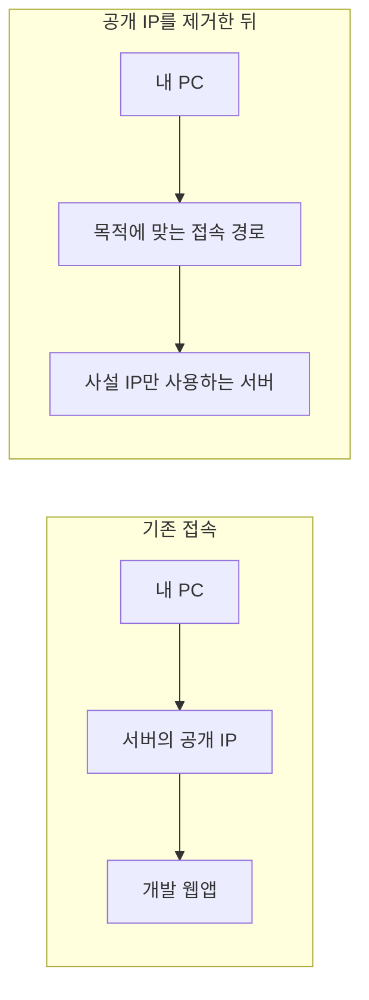
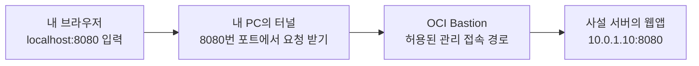
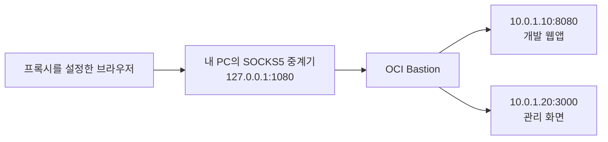
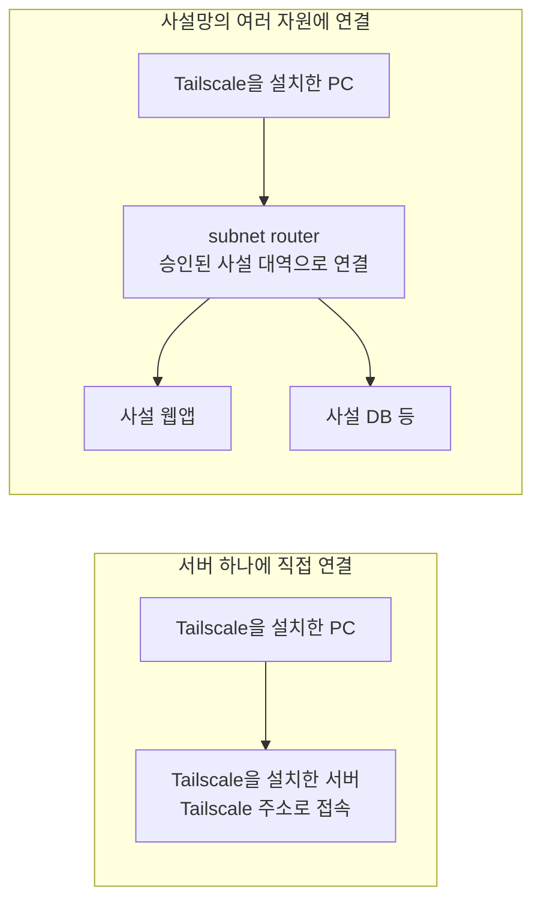
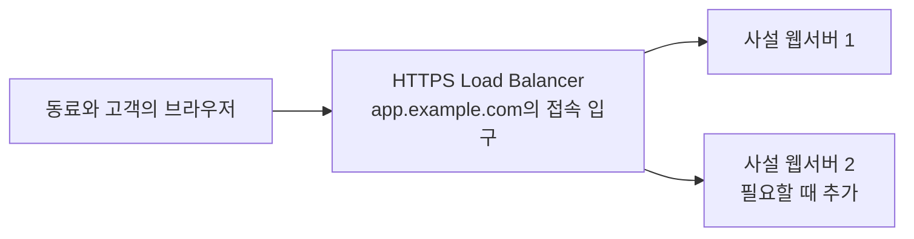
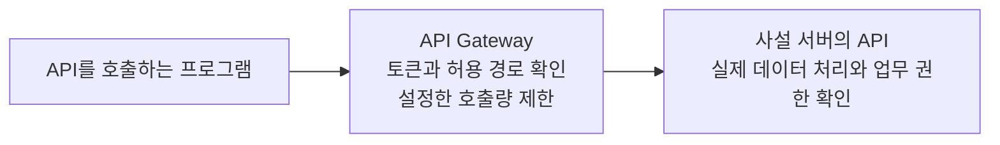
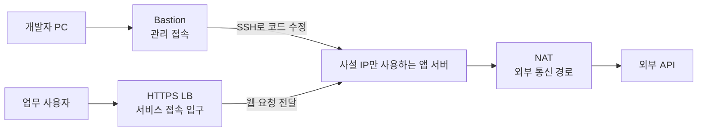

# 상황별 그림으로 이해하는 서버 접속

이 문서는 클라우드 서버를 처음 관리하는 IT 직원을 위한 안내입니다. 도구 이름을 외우기보다 **누가 무엇을 하려고 접속하는지**부터 정합니다. 그림은 역할과 요청 흐름을 이해하기 위한 것으로, 실제 배포에 필요한 방화벽·인증·라우팅 설정을 모두 표시한 구성도는 아닙니다.

예를 들어 본인이 서버의 코드를 수정하는 일, 동료가 완성된 웹 화면을 사용하는 일, 서버가 외부 AI API를 호출하는 일은 서로 다릅니다. 같은 서버에서도 이 세 경로를 함께 사용할 수 있습니다.

## 먼저 필요한 상황 선택

- [Public IP를 없애면 무엇이 달라지나요](#public-ip를-없애면-무엇이-달라지나요)
- [상황 1 개발 화면 하나나 SSH를 사용하고 싶습니다](#상황-1-개발-화면-하나나-ssh를-사용하고-싶습니다)
- [상황 2 여러 사설 웹 화면을 번갈아 보고 싶습니다](#상황-2-여러-사설-웹-화면을-번갈아-보고-싶습니다)
- [상황 3 앱마다 프록시를 설정하고 싶지 않습니다](#상황-3-앱마다-프록시를-설정하고-싶지-않습니다)
- [상황 4 하루 종일 여러 개발 도구로 작업합니다](#상황-4-하루-종일-여러-개발-도구로-작업합니다)
- [상황 5 동료나 고객이 웹사이트를 이용해야 합니다](#상황-5-동료나-고객이-웹사이트를-이용해야-합니다)
- [상황 6 다른 프로그램이 API를 호출합니다](#상황-6-다른-프로그램이-api를-호출합니다)
- [상황 7 로그인한 사용자에게 웹을 외부 중계로 제공합니다](#상황-7-로그인한-사용자에게-웹을-외부-중계로-제공합니다)
- [상황 8 서버에서 외부 API를 호출하거나 파일을 받습니다](#상황-8-서버에서-외부-api를-호출하거나-파일을-받습니다)
- [한 서버에서 여러 방법을 함께 쓰는 예](#한-서버에서-여러-방법을-함께-쓰는-예)
- [자주 나오는 용어](#자주-나오는-용어)

## Public IP를 없애면 무엇이 달라지나요

Public IP는 인터넷에서 서버를 찾아갈 때 사용하는 공개 주소입니다. Private IP는 클라우드 내부 같은 사설 네트워크에서 사용하는 주소입니다. Public IP를 제거해도 서버와 앱은 계속 실행될 수 있지만, 기존 공개 주소로 바로 들어가던 경로가 사라집니다.

핵심은 서버를 인터넷에 직접 노출하는 대신, **관리 목적의 접속인지 서비스 이용인지에 맞는 입구를 준비하는 것**입니다. 어떤 입구를 추가해도 사용자 인증과 필요한 포트만 허용하는 설정은 별도로 확인해야 합니다.

## 상황 1 개발 화면 하나나 SSH를 사용하고 싶습니다

**예:** 본인이 개발한 웹앱을 확인하거나, SSH로 서버에 들어가 코드를 수정하려고 합니다. SSH는 서버의 명령창을 원격으로 사용하는 접속 방식입니다.

**선택:** Bastion 고정 포트 포워딩부터 시작합니다. 여기서 Bastion은 OCI가 운영하는 제한된 관리 접속 서비스이고, 포트 포워딩은 내 PC의 특정 포트를 대상 서버 포트로 연결하는 방법입니다.

**왜 쓰나요:** 서버의 공개 IP를 없앤 상태에서도 본인이 필요한 서비스 한 곳에 접속할 수 있습니다. 브라우저의 프록시 설정을 바꿀 필요가 없습니다.

**사용자는 무엇을 하나요:** 터널 명령을 실행하고 브라우저에서 `http://127.0.0.1:8080`을 엽니다. `127.0.0.1`은 내 PC입니다. 웹앱을 PC로 복사한 것이 아니라 PC에서 받은 요청을 서버로 전달합니다. SSH라면 로컬 `2222`를 서버의 SSH 포트 `22`로 연결하는 식입니다.

**기억할 점:** 이 저장소의 고정 target 하나는 목적지 하나에 대응합니다. 다른 목적지는 별도 target과 로컬 포트로 연결합니다. Bastion 세션 만료 후에는 터널과 앱을 다시 연결해야 합니다.

[준비와 실행](../guides/easy-workflows.md#고정-포트-포워딩)

## 상황 2 여러 사설 웹 화면을 번갈아 보고 싶습니다

**예:** 개발 웹앱, 관리 대시보드, 사설 API의 상태 화면을 수시로 오갑니다. 웹 주소마다 포워딩을 따로 만드는 수고를 줄이고 싶습니다.

**선택:** Bastion SOCKS5를 검토합니다. SOCKS5는 앱이 “어느 주소의 어느 포트에 연결해 달라”고 중계기에 요청하는 규약입니다.

**왜 쓰나요:** 중계기를 하나 열어 두면, 앱이 연결할 때마다 목적지를 알려 주므로 여러 사설 서비스를 오가기 편합니다.

**사용자는 무엇을 하나요:** 브라우저의 SOCKS5 프록시 항목에 `127.0.0.1`, 포트에 `1080`을 넣고, **주소창에는** `http://10.0.1.10:8080`처럼 실제 서비스 주소를 입력합니다. 다음 탭에서 다른 사설 주소를 열 수 있습니다.

**기억할 점:** `http://127.0.0.1:1080`은 웹페이지 주소가 아닙니다. 프록시를 설정하지 않은 앱은 이 경로를 자동 사용하지 않습니다. 종료할 때는 브라우저 프록시도 원래 값으로 되돌립니다.

[브라우저 설정까지 따라하기](../guides/socks5-walkthrough.md)

## 상황 3 앱마다 프록시를 설정하고 싶지 않습니다

**예:** 브라우저뿐 아니라 명령행 도구 등으로 여러 사설 TCP 서비스에 접속합니다. 도구별 SOCKS5 설정을 반복하고 싶지 않습니다.

**선택:** sshuttle을 검토합니다. PC에서 지정한 사설 주소 대역으로 가는 연결을 SSH 경유로 중계합니다.

**왜 쓰나요:** 앱은 사설 주소에 평소처럼 접속하고, 선택한 대역에 대한 중계 처리를 sshuttle이 맡게 할 수 있습니다.

**사용자는 무엇을 하나요:** 먼저 터미널 하나에서 Bastion SSH 터널을 열고, 다른 터미널에서 `10.0.1.0/24`처럼 필요한 대역을 지정해 sshuttle을 실행합니다. `/24`는 주소 범위를 나타내는 표기입니다. 회사·집의 주소 범위와 겹치면 엉뚱한 경로를 사용할 수 있으므로 담당자와 범위를 확인합니다.

**기억할 점:** 이 구성은 Bastion 자체에서 프로그램을 실행하는 것이 아닙니다. 그 뒤의 Linux VM에서 Python을 실행하며, PC에는 방화벽 설정 권한이 필요합니다. Bastion의 세션 시간 제약도 남습니다. 모든 VPN 기능이나 UDP·ping 전체를 제공한다고 가정하지 않습니다.

[두 터미널 실행 순서](../guides/easy-workflows.md#sshuttle)

## 상황 4 하루 종일 여러 개발 도구로 작업합니다

**예:** 하루 동안 SSH·브라우저·DB 도구를 계속 쓰는데 개별 터널이나 세션 만료가 번거롭습니다.

**선택:** 기존 회사 VPN으로 대상 서버까지 도달하는지 먼저 확인합니다. 새 구성이 필요하고 조직에서 허용한다면 Tailscale 같은 사설망 접속 방법을 검토합니다. VPN은 떨어진 PC와 네트워크 사이에 접속 경로를 만드는 방식입니다.

Tailscale에는 **서버마다 클라이언트를 설치하는 방식**과 **사설망 연결을 맡는 서버를 두는 방식**이 있습니다.

**왜 쓰나요:** 앱마다 프록시나 로컬 포트를 정하는 대신, 승인된 사설망 접속 경로를 공통으로 사용할 수 있습니다. Bastion을 경유하지 않는 구성은 Bastion 세션 만료와 독립됩니다.

**사용자는 무엇을 하나요:** PC와 서버를 조직 계정에 등록합니다. 서버 직접 연결은 Tailscale이 부여한 주소를 쓰고, 원래 사설 주소를 쓸 경우 subnet router의 경로 광고·승인·접속 권한·PC의 경로 수신 설정을 준비합니다. 기존 회사 VPN은 네트워크 담당자가 제공한 연결 방식과 범위를 따릅니다.

**기억할 점:** Tailscale 설치만으로 OCI의 모든 `10.x` 주소에 접근할 수 있는 것은 아닙니다. 경로를 알리는 것과 그 경로로 누가 무엇에 접속할 수 있는지 허용하는 것은 별개입니다. 외부 계정·통신 경로 사용의 허용 여부와 운영 주체도 정해야 합니다.

[Tailscale 실행과 확인](../guides/easy-workflows.md#tailscale) · [회사망 연결 준비](../guides/alternatives.md#회사망-연결-요청에-필요한-정보)

## 상황 5 동료나 고객이 웹사이트를 이용해야 합니다

**예:** 동료에게 데모 URL을 알려 주거나 고객이 업무 웹사이트를 사용하게 합니다. 사용자마다 OCI 키와 터널을 준비하게 하기 어렵습니다.

**선택:** HTTPS Load Balancer, 줄여서 LB를 웹서비스의 입구로 사용합니다. LB는 사용자 요청을 받아 내부의 웹서버에 전달합니다.

**왜 쓰나요:** 사용자는 평소처럼 HTTPS 주소를 열고, 서버는 사설 IP로 운영할 수 있습니다. 웹서버가 여러 대이면 요청을 나누는 역할도 합니다. 서버가 한 대여도 입구를 분리하려고 사용할 수 있습니다.

**사용자는 무엇을 하나요:** 제공받은 웹 URL을 열고 앱에 로그인합니다. 운영자는 도메인·HTTPS 인증서·LB와 서버 사이 방화벽·서버의 정상 응답 검사를 설정합니다.

**기억할 점:** LB를 만들었다고 사용자 로그인이 자동으로 생기지는 않습니다. 앱 인증은 유지해야 합니다. LB 자체의 공개 입구는 남으므로 필요한 공개 범위와 정책도 확인합니다.

[HTTPS LB 구성](../guides/infrastructure.md#https-load-balancer)

## 상황 6 다른 프로그램이 API를 호출합니다

**예:** 다른 시스템이 `/api/orders` 같은 주소로 데이터 조회를 요청합니다. 호출자의 토큰을 확인하고 지나치게 많은 요청도 제한하고 싶습니다. API는 프로그램끼리 요청과 응답을 주고받도록 정한 인터페이스입니다.

**선택:** API Gateway를 검토합니다. API 앞에서 경로·메서드·인증 등 설정한 조건을 확인하고 요청을 전달하는 서비스입니다.

**왜 쓰나요:** API의 공통 접속 정책을 입구에서 적용할 수 있습니다. 앱마다 같은 기본 검사를 반복하는 수고를 줄일 수 있습니다.

**사용자는 무엇을 하나요:** 정해진 HTTPS API 주소와 발급받은 인증 정보를 사용합니다. 운영자는 인증 공급자·검증 조건·허용 API 경로를 구성합니다.

**기억할 점:** 토큰은 호출자의 인증 정보를 전달하는 값입니다. Gateway가 로그인 앱이나 토큰 발급자를 자동으로 만들어 주지는 않습니다. 인증된 사용자라도 특정 주문을 볼 권한이 있는지는 앱에서 별도로 판단할 수 있습니다. 앱이 이미 요구 기능을 제공한다면 LB만으로도 충분한지 검토합니다.

[JWT 인증 API 예제](../guides/infrastructure.md#api-gateway)

## 상황 7 로그인한 사용자에게 웹을 외부 중계로 제공합니다

**예:** 조직에서 외부 중계 서비스 사용을 허용하고, 직원이 브라우저 로그인 후 사설 웹앱을 이용하게 하려고 합니다.

**선택:** Cloudflare Tunnel와 Cloudflare Access를 함께 검토합니다. Tunnel은 웹앱까지 연결하는 경로를, Access는 누가 이용할 수 있는지 확인하는 역할을 맡습니다.

실선은 웹 요청이 전달되는 논리적 경로입니다. 점선은 서버의 `cloudflared`가 먼저 외부로 연결을 만든다는 뜻입니다. 인터넷에서 VM의 Public IP로 직접 들어오는 구성이 아니어도 동작할 수 있지만, 서버의 외부 통신 경로는 필요합니다.

**왜 쓰나요:** 사용자가 접속 도구를 설치하지 않고 브라우저와 로그인으로 웹앱을 이용하게 할 수 있습니다. 서버 측에는 웹앱으로 요청을 전달할 연결 프로그램을 둡니다.

**사용자는 무엇을 하나요:** 제공받은 웹 주소에서 로그인합니다. 운영자는 계정·도메인·터널·웹앱 연결과 Access 허용 정책을 준비합니다. 이 저장소는 로컬 설정 파일로 관리하는 named tunnel의 실행 도우미를 제공합니다.

**기억할 점:** Tunnel만 만들면 Access 로그인 정책이 자동으로 생기는 것이 아닙니다. 외부 서비스로 통신 경로가 추가되는 만큼 조직의 사용 허용 여부와 데이터 취급 조건을 확인합니다.

[준비부터 실행까지](../guides/easy-workflows.md#cloudflare-tunnel)

## 상황 8 서버에서 외부 API를 호출하거나 파일을 받습니다

**예:** 사설 서버가 외부 AI API를 호출하거나 운영체제 업데이트 파일을 받으려고 합니다.

**선택:** 인터넷 외부 통신이 필요하다면 NAT Gateway와 적절한 경로를 준비합니다. NAT는 여기서 서버의 사설 주소를 외부 통신에 사용할 주소로 바꿔 주는 역할을 합니다.

**왜 쓰나요:** VM마다 Public IP를 붙이지 않고도 서버에서 외부로 요청을 보낼 수 있게 하기 위해서입니다.

**사용자는 무엇을 하나요:** 이 경우의 요청자는 직원 PC가 아니라 서버의 프로그램입니다. 운영자는 라우트 테이블과 외부 통신 규칙을 준비하고 실제 외부 API 응답을 확인합니다.

**기억할 점:** NAT를 만든다고 직원의 PC에서 SSH로 들어가는 경로가 생기지는 않습니다. 경로를 바꾸면 같은 서브넷의 다른 자원에도 영향을 줄 수 있습니다. 외부 서비스가 출구 IP를 허용 목록으로 관리한다면 NAT의 출구 IP도 맞춰야 합니다.

[NAT 구성과 경로 전환](../guides/infrastructure.md#nat-gateway)

## 한 서버에서 여러 방법을 함께 쓰는 예

팀이 업무 웹앱을 개발하는 상황입니다. 개발자는 서버를 관리하고, 동료는 웹앱을 이용하고, 서버는 외부 API를 호출합니다.

이 구성에서 **개발자는 Bastion으로 서버를 관리하고, 업무 사용자는 LB의 웹 주소를 사용하며, 서버는 NAT를 통해 외부로 요청합니다.** 역할에 맞게 필요한 경로를 함께 사용합니다. 웹 로그인과 업무 권한 검사는 앱에 유지합니다.

처음 담당한다면 본인의 접속 하나를 고정 포워딩으로 확인하고, 실제 서비스 사용자와 사용 시간·필요한 도구가 정해졌을 때 다른 선택지를 추가해 보십시오. 모든 도구를 한꺼번에 설치하는 것이 목표는 아닙니다.

## 자주 나오는 용어

| 용어 | 이 문서에서의 뜻 |
|---|---|
| Compute VM | 클라우드에서 실행하는 가상 서버 |
| Public IP | 인터넷에서 찾아갈 때 쓰는 공개 주소 |
| Private IP | 사설 네트워크 안에서 사용하는 주소. PC에 접속 경로가 있어야 접근 가능 |
| 포트 | 한 컴퓨터의 여러 서비스 중 어느 서비스에 연결할지 구분하는 번호 |
| localhost 또는 127.0.0.1 | 이 주소를 사용하는 컴퓨터 자신 |
| SSH | 서버의 명령창 등에 암호화된 원격 접속을 제공하는 방식 |
| 터널 | 다른 연결 안으로 필요한 통신을 전달하는 경로 |
| 프록시 | 앱 대신 목적지에 연결하거나 요청을 중계하는 프로그램 |
| DNS | 서비스 이름에 대응하는 주소를 찾는 기능 |
| VCN | OCI 안에 만드는 사설 네트워크 |
| NSG와 방화벽 | 어떤 출발지에서 어떤 포트로 접속할 수 있는지 허용 규칙을 정하는 수단 |
| CIDR | `10.0.1.0/24`처럼 IP 주소 범위를 나타내는 표기 |
| 인증과 권한 | 인증은 누구인지 확인, 권한은 그 사용자가 무엇을 할 수 있는지 결정 |

구체적인 계정·방화벽·경로 설정은 [방법별 사용 절차](../guides/easy-workflows.md)를 따릅니다. [검증 결과](../validation.md)의 로컬 검사와 실제 계정·네트워크 검증 범위를 구분해 읽으십시오.

근거: [OCI Bastion](https://docs.oracle.com/en-us/iaas/Content/Bastion/Concepts/bastionoverview.htm), [sshuttle](https://sshuttle.readthedocs.io/en/stable/usage.html), [Tailscale subnet router](https://tailscale.com/docs/features/subnet-routers), [Cloudflare Tunnel와 Access](https://developers.cloudflare.com/cloudflare-one/setup/secure-private-apps/private-web-app/), [LB·API Gateway·NAT 공식 문서 모음](../reference/sources.md).
