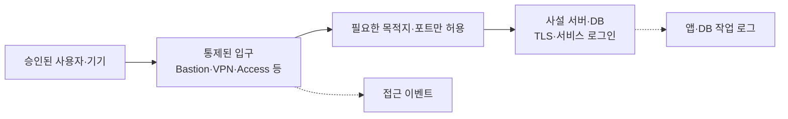

# 사설 접속의 보안 효과와 검증 기준

보안 효과는 **노출 축소 → 접근자 제한 → 목적지 제한 → 암호화·서비스 인증 → 감사·회수** 순서로 확인합니다. 제품을 설치했다는 사실보다 실제 허용 범위가 기준입니다.

| 통제 | 보안상 의미 | 검증 기준 |
|---|---|---|
| 인터넷 직접 노출 제거 | 취약한 관리 포트를 인터넷 전체가 직접 공격하기 어려워짐 | Public IP·공개 endpoint·IPv6·기존 우회 경로 확인 |
| 사용자·기기 인증 | 허용한 주체만 입구를 이용 | 승인 사용자 성공, 비승인 사용자 거부, 키·기기 회수 확인 |
| 최소 목적지·포트 | 계정·경유 VM이 침해돼도 이동 가능한 범위 축소 | 허용 대상 성공, 다른 서버·포트 거부 |
| 시간 제한·정리 | 임시 접속 경로가 계속 남는 문제 감소 | 세션 만료·삭제 후 재접속 차단, 임시 규칙 복구 |
| TLS·인증서 검증 | 잘못된 서버 접속과 구간 도청 위험 감소 | 실제 서비스 이름·신뢰 체인 검증, 검증 생략 옵션 없음 |
| 서비스 권한 | 접속 성공 후에도 허용된 데이터·기능만 사용 | 일반 사용자의 관리자 기능·타인 데이터 접근 거부 |
| 감사·작업 로그 | 누가 경로를 만들고 무엇을 했는지 사후 확인 | 접속 시각·사용자·대상을 연계, DB·앱 작업 기록 별도 확보 |

## 방식별 주의점

- **Bastion:** 고정 포워딩은 목적지 한 곳을 지정합니다. SOCKS5는 여러 목적지를 요청할 수 있으므로 네트워크 허용 범위를 좁혀야 합니다. 로컬 중계기는 `127.0.0.1`에만 바인딩합니다.
- **sshuttle:** 경유 Linux VM이 여러 대상에 접근합니다. VM의 패치·계정·키·출발지 권한도 관리해야 합니다. 넓은 CIDR 지정은 접근 범위를 키울 수 있습니다.
- **Tailscale:** 기기 등록과 접근 허용은 별개입니다. subnet router가 광고하는 대역과 사용자별 접근 정책을 함께 제한합니다. 조직이 승인한 계정·외부 통신만 사용합니다.
- **Cloudflare:** Tunnel은 전달 경로이며 Access가 사용자 인증을 담당합니다. 공개 호스트 이름 자체가 사설 IP가 되는 것은 아닙니다. 중계망·데이터 취급 조건과 원본 우회 차단을 확인합니다.
- **ADB:** Private Endpoint와 공개 접속을 함께 허용할 수 있습니다. 사설 전용 요구라면 공개 접속을 끄고 SQL·HTTPS 접근 규칙과 DB 계정 권한을 각각 검증합니다.

보안 검증은 **접속 허용과 거부를 모두 시험**합니다. 사설 IP·터널·VPN 사용만으로 조직 정책 충족을 확정하지 않습니다.

근거: [OCI Bastion 보안](https://docs.oracle.com/en-us/iaas/Content/Security/Reference/bastion_security.htm), [ADB 네트워크 선택](https://docs.oracle.com/en-us/iaas/autonomous-database-serverless/doc/network-access-options.html), [Tailscale 접근 제어](https://tailscale.com/docs/features/access-control), [Cloudflare 인증된 웹 접근](https://developers.cloudflare.com/cloudflare-one/setup/secure-private-apps/private-web-app/).
