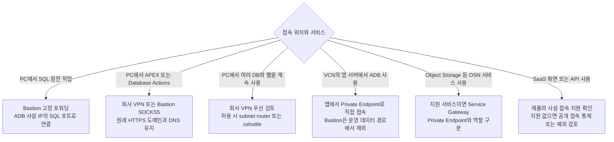
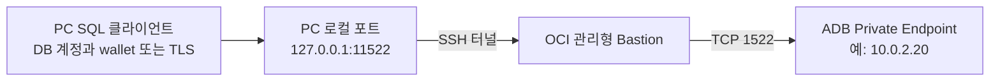
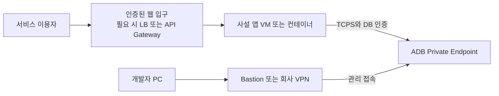
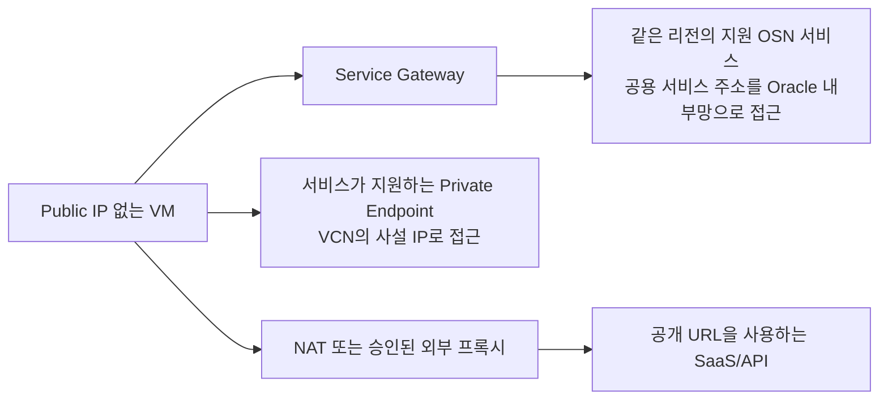

# ADB·관리형 서비스에 Public IP 없이 접속하기

이 문서는 개발자 PC나 사설 앱 서버에서 Autonomous Database(ADB)의 SQL·웹 도구에 접속할 경로를 고르는 안내입니다. **ADB는 관리형 데이터베이스 PaaS**입니다. 일반 SaaS까지 같은 설정으로 사설화할 수 있는 것은 아닙니다. 여기서는 ADB Serverless를 기준으로 설명하며 다른 배포 유형은 해당 제품 문서로 확인합니다.

먼저 아래 세 가지를 구분해야 합니다.

| 요구사항 | 확인할 것 |
|---|---|
| 접속하는 VM에 Public IP를 붙이지 않겠다 | VM의 사설 경로 또는 NAT·Service Gateway 등 외부 통신 경로 |
| DB 자체를 인터넷에서 접속할 수 없게 하겠다 | ADB의 **Private endpoint access only**와 공개 접속 비활성화 |
| PC부터 DB까지 인터넷을 통과하지 않겠다 | 회사망에서 VCN까지 VPN·FastConnect와 DNS·라우팅. PC의 회사망 접속 구간도 별도 확인 |

Bastion은 DB를 사설로 유지한 채 관리 접속을 중계합니다. **PC→Bastion 접속은 공용 서비스 주소를 이용**하므로 전체 경로가 전용망이라는 뜻은 아닙니다. 또한 ADB는 Private Endpoint와 공개 접속을 함께 허용할 수도 있습니다. Private Endpoint가 있다는 사실만 보고 공개 접속이 차단됐다고 판단하지 않습니다. [ADB 네트워크 선택](https://docs.oracle.com/en-us/iaas/autonomous-database-serverless/doc/network-access-options.html) · [Bastion 개념](https://docs.oracle.com/en-us/iaas/Content/Bastion/Concepts/bastionoverview.htm)

## 1. 접속 경로 선택



| 구성 요소 | 역할 | 별도로 필요한 것 |
|---|---|---|
| Private Endpoint | 서비스를 VCN 안의 사설 IP로 접속하게 함 | 해당 서비스의 기능 지원, 서브넷·NSG |
| Bastion | 제한된 시간 동안 PC의 TCP 연결을 사설 목적지로 중계 | OCI 권한·키·접속 출구 허용 목록 |
| VPN·FastConnect | 회사망과 VCN 사이의 연결 경로 제공 | 양쪽 라우트·반환 경로·보안 규칙 |
| DNS | 서비스 이름을 올바른 IP로 변환 | PC에서도 사설 이름을 조회할 설정 |
| DB TLS·wallet | DB 신원 검증, 암호화와 필요한 경우 클라이언트 인증 | 지원 드라이버·인증서·DB 계정 권한 |

네트워크가 연결되어도 DB 로그인 권한은 생기지 않습니다. OCI Console을 열 수 있는 것과 DB의 SQL·HTTPS에 접속할 수 있는 것도 별개입니다.

## 2. PC에서 ADB SQL 접속: Bastion 고정 포워딩

한두 DB에 간헐적으로 작업하고 회사 VPN에서 DB 사설망으로 갈 수 없을 때 검토합니다. DB에 SSH 서버나 Oracle Cloud Agent를 설치하지 않습니다. Bastion이 **ADB의 TCP 포트**로 연결합니다. [Oracle의 DB 포워딩 절차](https://docs.oracle.com/en-us/iaas/Content/Bastion/Tasks/connect-port-forwarding.htm) · [대상 agent가 필요 없는 세션](https://docs.oracle.com/en-us/iaas/Content/Bastion/Tasks/create-session-port-forwarding.htm)



### 준비 확인

1. ADB에서 Private Endpoint를 구성하고, 공개 접속이 불필요하면 **Allow public access를 끕니다**. 기존 앱의 접속 경로가 바뀌므로 먼저 의존성을 확인합니다.
2. ADB와 **같은 VCN**의 Bastion을 사용합니다. 관리형 Bastion은 다른 VCN의 대상에 직접 접속하는 용도로 지원되지 않습니다.
3. ADB의 사설 IP·접속 문자열·인증 방식·서비스명을 확인합니다. IP는 터널 목적지, 서비스명은 DB 안에서 연결할 서비스를 지정하는 값입니다.
4. ADB NSG·서브넷 규칙에서 Bastion 사설 엔드포인트 IP를 출발지로 필요한 DB 포트만 허용합니다. ZPR 사용 환경이면 해당 정책도 확인합니다.
5. PC의 실제 공인 출구 IP를 Bastion allowlist에 포함하고 outbound SSH 연결을 확인합니다. DB 비밀번호와 SSH 키는 서로 다른 인증 수단입니다.

| ADB 연결 | 대상 포트 | 클라이언트 준비 |
|---|---|---|
| mTLS | 1522 | wallet과 지원 DB 드라이버, DB 계정 |
| TLS | 1521 또는 1522 | ADB에서 TLS 허용, 지원 클라이언트·신뢰 CA·DB 계정. 실제 제공 접속 문자열 사용 |
| APEX·Database Actions·ORDS HTTPS | 443 | SQL 터널과 별개인 웹 경로와 로그인 |

포트만 보고 인증 방식을 추측하지 않습니다. 특히 TLS도 1522를 사용할 수 있습니다. [ADB 인증과 포트](https://docs.oracle.com/en-us/iaas/autonomous-database-serverless/doc/connect-introduction.html) · [Private Endpoint 보안 규칙](https://docs.oracle.com/en-us/iaas/autonomous-database-serverless/doc/private-endpoints-autonomous.html)

### 셸로 터널 열기

저장소 루트에서 실행합니다. 실제 파일이 이미 있다면 복사로 덮어쓰지 않습니다.

```sh
cp config/managed-services.example.json config/managed-services.json
```

파일의 OCI 프로파일·Bastion·키 경로를 실제 값으로 바꾸고, `adb-mtls.host`를 실제 ADB 사설 IP로 수정합니다. 예제 IP는 연결 가능한 자원이 아닙니다. 이 도우미의 고정 목적지는 **RFC1918 사설 IPv4**를 받으며 FQDN은 받지 않습니다. DB가 재생성되거나 엔드포인트가 바뀌면 IP를 다시 확인합니다.

```sh
OCI_ACCESS_CONFIG=config/managed-services.json sh scripts/workflow.sh validate
OCI_ACCESS_CONFIG=config/managed-services.json sh scripts/workflow.sh doctor
OCI_ACCESS_CONFIG=config/managed-services.json sh scripts/workflow.sh plan adb-mtls
# 실제 OCI 세션을 만들고 SSH 터널을 유지합니다.
OCI_ACCESS_CONFIG=config/managed-services.json sh scripts/workflow.sh connect adb-mtls --execute
```

계획에서 `127.0.0.1:11522` → 실제 ADB 사설 IP의 `1522`인지 확인합니다. TLS 예제 `adb-tls`는 `11521` → `1521`입니다. 실제 접속 문자열이 TLS 1522를 지정하면 대상 포트를 그 값으로 바꿉니다. 터널은 TCP 경로만 만들며 wallet·DB 연결 설정을 자동 변경하지 않습니다.

### SQL 클라이언트 설정: 경로와 인증서 이름을 함께 맞추기

ADB의 원본 접속 문자열은 보통 `TCPS + 원래 DB FQDN + 서비스명 + 서버 인증서 검증`을 포함합니다. FQDN은 서비스의 전체 도메인 이름입니다. 단순히 호스트를 `localhost`로 바꾸면 클라이언트에 따라 인증서 이름 검증·SNI가 실패할 수 있습니다. SNI는 TLS 연결 시 클라이언트가 접속하려는 서버 이름을 알려 주는 값입니다.

가장 단순한 구성은 **VPN과 사설 DNS로 원본 접속 문자열을 그대로 쓰는 것**입니다. 고정 터널을 사용할 때는 다음과 같이 클라이언트 설정을 준비합니다.

1. wallet이 필요한 경우 PC의 저장소 밖 전용 디렉터리에 보관합니다. 원본을 보존하고 터널용 복사본의 `tnsnames.ora`에서 사용할 별칭 하나만 편집합니다.
2. 해당 별칭의 **원래 DB FQDN·TCPS·서비스명·서버 인증서 검증 설정을 유지**하고 포트를 로컬 포트 `11522`로 바꿉니다. wallet 경로는 사용하는 클라이언트 방식에 맞춥니다.
3. PC의 hosts 파일에 **그 FQDN 하나만** `127.0.0.1`로 연결하는 임시 항목을 둡니다. 예: `127.0.0.1 <원래-DB-FQDN>`. 시스템 파일 수정이 허용된 환경에서만 적용하고 기존 항목을 기록합니다. 와일드카드 도메인은 쓰지 않습니다.
4. SQLcl 또는 SQL*Plus의 TNS 별칭으로 로그인합니다. 비밀번호는 프롬프트에서 입력하며, 명령·설정 파일에 저장하지 않습니다. 아래 경로와 계정·별칭은 실제 값으로 바꿉니다.

```sh
TNS_ADMIN="$HOME/.oci/adb-wallet-tunnel" sql APP_USER@ADB_TUNNEL_ALIAS
```

이때 연결 흐름은 `원래 DB FQDN:11522` → PC 이름 조회 결과 `127.0.0.1:11522` → Bastion → DB의 `1522`입니다. TLS 계층에는 원래 DB 이름을 유지합니다. Oracle의 [ADB SSH 터널 예제](https://docs.oracle.com/en/solutions/migrate-tomcat-workloads/migrate-application-database.html)도 원래 호스트 이름을 로컬로 연결하는 방식을 설명합니다. 이 저장소는 공개 점프 VM 대신 관리형 Bastion을 사용합니다. 클라이언트별 wallet 로딩·이름 검증 동작은 실제 버전에서 확인해야 합니다.

hosts 수정이 허용되지 않으면 VPN·사설 DNS를 선택하거나, 해당 DB 클라이언트가 지원하는 터널 기능에서 **연결 목적지와 TLS 검증 이름을 분리하는 공식 설정**을 사용합니다. `SSL_SERVER_DN_MATCH`를 끄거나 인증서 오류를 무시하는 것으로 해결하지 않습니다.

성공 기준은 터널 프로세스가 켜진 상태가 아니라 **대상 DB에 로그인하고 다음 조회가 성공하는 것**입니다.

```sql
SELECT SYS_CONTEXT('USERENV', 'DB_NAME') AS DB_NAME FROM DUAL;
```

종료 시 DB 연결을 닫고 hosts의 이번 임시 항목·편집한 별칭을 복구한 다음 터널을 `Ctrl+C`로 끕니다. 터널용 wallet 복사본은 조직의 보관·폐기 기준에 따라 처리합니다. OCI 세션은 실행 시 출력된 삭제 명령으로 정리하거나 TTL 만료를 기다립니다. 최대 3시간 세션이므로 운영 앱의 상시 DB 연결 경로로 사용하지 않습니다.

## 3. APEX·Database Actions: HTTPS와 원래 이름 유지

SQL Worksheet는 [사설 HTTPS 페이지 접속 절차](worksheet.md)를 먼저 사용합니다. 고정 443 포워딩과 브라우저 내부의 도메인·포트 매핑으로 실제 로그인 화면을 확인한 방법입니다. 기존 점프 VM에서 검증했으며 관리형 Bastion의 실접속 검증과는 구분합니다.

SQL 포트 터널을 열어도 브라우저 화면은 열리지 않습니다. 웹 도구는 443과 해당 URL을 사용합니다. ADB의 웹 도구는 여러 호스트·리다이렉트·쿠키가 관련될 수 있어, 단순한 `https://localhost:8443`보다 **원래 URL을 유지하는 경로**를 먼저 선택합니다. [Database Actions 접근](https://docs.oracle.com/en-us/iaas/autonomous-database-serverless/doc/connect-database-actions.html)

| 경로 | 사용 방법 | 사전 조건 |
|---|---|---|
| 회사 VPN·FastConnect | PC 브라우저에서 원래 사설 HTTPS URL 열기 | 회사망→VCN 경로, 사설 DNS, 443 허용 |
| Bastion SOCKS5 | 브라우저 프록시·원격 DNS 설정 후 원래 URL 열기 | FQDN/SOCKS5 활성화, **해당 웹 도메인이 사설 IP로 해석되는지 확인**, 443 허용 |
| Tailscale subnet router | 사설 대역 route를 승인·수신하고 원래 URL 열기 | 별도 경유 VM, IP forwarding, 접근 정책·DNS 설정 |
| sshuttle | 사설 대역과 필요한 DNS 중계 후 원래 URL 열기 | 경유 Linux VM의 Python·DNS·대상 접근 가능 |

SOCKS5 예제는 SQL 터널과 같은 설정 파일에서 실행할 수 있습니다.

```sh
OCI_ACCESS_CONFIG=config/managed-services.json sh scripts/workflow.sh connect managed-socks --execute
```

브라우저에 SOCKS5 `127.0.0.1:1080`과 프록시 DNS 조회를 설정한 뒤, OCI에서 확인한 **실제 Private Endpoint용 웹 URL**을 엽니다. [브라우저 설정·검증·복구 절차](socks5-walkthrough.md)를 따릅니다. URL을 IP·localhost로 치환하거나 `curl -k`로 인증서를 우회하지 않습니다. **올바른 VCN의 경유지가 웹 도메인을 ADB 사설 IP로 해석하는지 확인합니다.** 테스트에서 다른 VCN을 주 NIC로 쓰는 VM은 공용 IP를, 같은 VCN의 점프 VM은 사설 IP를 반환했습니다. 필요하면 사설 DNS 레코드·조건부 전달을 준비하거나 [고정 터널과 도메인 매핑](worksheet.md)을 사용합니다.

**APEX Service와 일반 ADB에서 APEX를 사용하는 것은 구분합니다.** 별도 APEX Service에는 inbound SQL*Net 클라이언트 연결 제한이 있으므로 이 문서의 `adb-mtls` 예제를 적용할 수 없습니다. 해당 서비스의 HTTPS 기능을 사용합니다. [APEX Service 제한](https://docs.oracle.com/en-us/iaas/autonomous-database-serverless/doc/apex-workload-limitations.html)

## 4. 앱 서버가 ADB를 사용할 때



앱 서버가 DB 사설 IP에 도달할 수 있으면 **앱→DB를 직접 연결**합니다. 앱에 DB 접속 문자열·wallet 또는 TLS·최소 권한 계정을 설정하고, ADB 보안 규칙은 앱의 NSG 또는 필요한 출발지로 제한합니다. 다른 VCN이면 별도 피어링·DRG 경로와 반환 경로·DNS 설계가 필요합니다.

LB/API Gateway는 사용자용 웹 입구입니다. 이것을 만들었다고 DB의 공개 접속이 사라지거나 SQL 연결이 사설화되지는 않습니다. 개발자용 Bastion 세션을 운영 앱의 DB 경유지로 사용하면 세션 만료가 서비스 장애로 이어질 수 있습니다.

## 5. Service Gateway와 SaaS의 적용 범위



Service Gateway는 지원되는 Oracle Services Network(OSN) 서비스로 가는 경로입니다. 서비스의 **공용 주소를 사용하면서 인터넷을 통과하지 않을 수 있습니다**. 서비스 자체의 엔드포인트를 사설 IP로 바꾸는 기능과 다릅니다. 같은 리전의 지원 서비스·라우트·보안 규칙을 확인해야 합니다. [Service Gateway 공식 범위](https://docs.oracle.com/en-us/iaas/Content/Network/Tasks/servicegateway.htm)

| 대상 | 판단과 구성 |
|---|---|
| ADB | 서비스 자체의 Private Endpoint를 우선 검토. 공개 ACL 허용 방식과 구분 |
| MySQL DB System 등 사설 DB | 제품이 제공하는 사설 주소·포트·TLS를 확인. Bastion TCP 포워딩 또는 VPN으로 접근 가능 여부 검토 |
| Object Storage 등 OSN 지원 서비스 | 사설 VM의 Service Gateway 경로와 서비스 인증·권한을 구성. 버킷은 Private로 유지 |
| 다른 관리형 PaaS | **클라이언트→서비스 inbound Private Endpoint** 지원 여부를 확인. 서비스가 다른 DB를 호출하는 outbound private 기능과 혼동하지 않음 |
| Fusion 등 SaaS | 제품·에디션·리전·계약의 사설 접속 옵션을 서비스 담당자와 확인. 고객이 임의로 그 SaaS에 Bastion·Tailscale을 설치할 수 있다고 가정하지 않음 |
| 공개 URL만 지원하는 SaaS/API | Public IP 없는 VM에서 NAT·승인된 프록시로 호출 가능. 서비스 자체는 공용 endpoint이므로 ‘완전 사설 접속’ 요구는 충족하지 않음 |

SaaS 검토 시에는 **사용자 브라우저 접속인지, 시스템 간 API인지 → 사설 inbound 지원 여부 → 경로와 DNS → SSO·API 인증 → 접속 출구 제한 → 감사 로그** 순서로 확인합니다. Bastion이나 LB를 앞에 둬도 공급자의 원래 공개 URL을 자동으로 차단하지는 않습니다. 지원되지 않는 요구는 서비스 대체나 승인된 예외가 필요할 수 있습니다.

## 6. 연결 확인과 장애 위치

아래 순서로 확인하면 네트워크 문제와 인증 문제를 구분할 수 있습니다. 실제 검사 PC·VM의 위치도 함께 기록합니다.

| 단계 | 확인 항목 | 실패 시 확인 위치 |
|---|---|---|
| 1 이름 | 원래 FQDN이 의도한 사설 IP 또는 터널용 loopback으로 해석됨 | VPN DNS·조건부 전달·hosts. hosts 검사는 OS resolver 사용; nslookup은 hosts를 검증하지 않음 |
| 2 경로 | 해당 위치에서 DB TCP 포트 또는 HTTPS 443에 도달 | Bastion allowlist·세션·라우트·NSG·Security List·ZPR |
| 3 TLS | 원래 서비스 이름과 신뢰 체인 검증 성공 | FQDN·SNI·클라이언트 버전·wallet·CA |
| 4 로그인 | DB 또는 웹 로그인 성공 | DB 사용자·서비스명·계정 잠금·SSO·권한 |
| 5 기능 | SQL 조회 또는 실제 웹 화면·API 동작 | 웹의 추가 호스트·CORS·앱 권한·접속 문자열 |
| 6 차단 | 승인되지 않은 출발지의 접근 거부 | 공개 접속 잔존·과도한 NSG/ACL·접근 정책 |
| 7 종료 | 임시 hosts·프록시·터널·테스트 권한 복구 | PC 설정과 OCI 세션 TTL·정리 |

로컬 예제 검증과 실제 ADB 연결 시험은 다릅니다. 이 저장소에서 수행한 범위는 [검증 결과](../validation.md)를 확인하십시오. wallet·비밀번호·실제 접속 문자열·고객 데이터는 이 공개 저장소에 올리지 않습니다.
