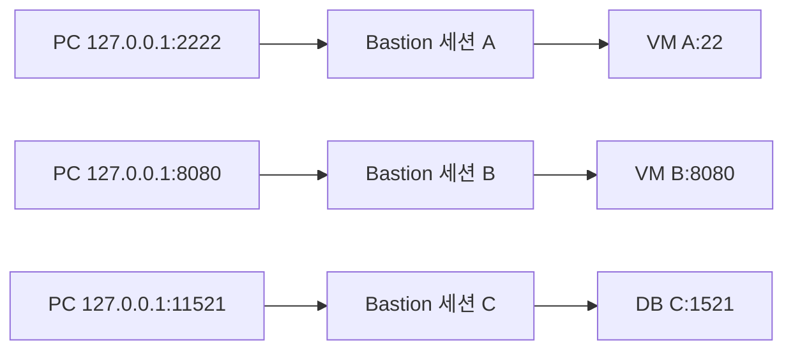
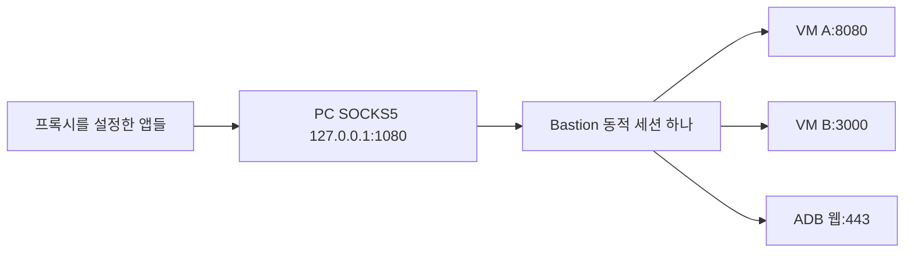
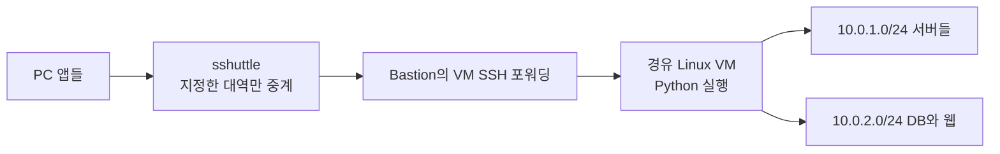
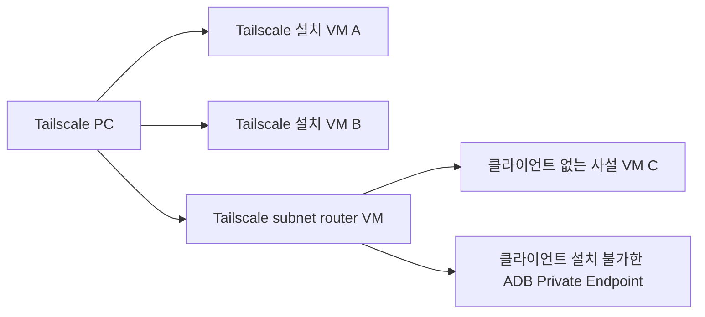
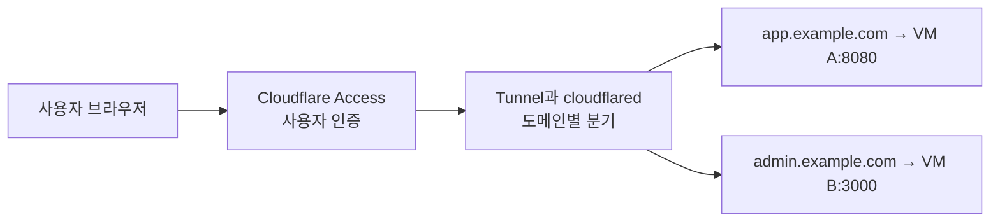

# 여러 서버에 동시에 접속하기

여러 서버를 동시에 사용할 수 있습니다. **목적지마다 터널을 여는지, 한 연결에서 여러 목적지를 선택하는지**가 다릅니다. 동시 접속은 부하 분산이나 무제한 용량을 뜻하지 않습니다.

| 방법 | 여러 서버 연결 방식 | 설치·실행 위치 | 앱이 사용하는 주소 |
|---|---|---|---|
| 고정 포워딩 | 이 도우미는 **target별 세션·터널** | PC SSH, OCI Bastion | 목적지별 `127.0.0.1:로컬포트` |
| SOCKS5 | **프록시 하나로 여러 목적지** | PC SSH·프록시 지원 앱, OCI Bastion | 실제 사설 IP 또는 도메인 |
| sshuttle | **경유 VM 하나에서 여러 목적지**, CIDR 여러 개 지정 | PC와 Python이 있는 경유 Linux VM | 실제 사설 IP 또는 도메인 |
| Tailscale | 등록 기기에 직접 연결하거나 **subnet router에서 여러 목적지로 전달** | PC와 각 서버, 또는 PC와 router VM | Tailscale 주소 또는 원래 사설 주소 |
| Cloudflare Tunnel·Access | **터널 하나에 여러 웹 호스트 규칙** | 목적지에 도달하는 VM의 cloudflared | 서비스별 HTTPS 도메인 |

도구가 처음이면 [이름과 역할](../explanation/beginner-guide.md#도구-개요)을 먼저 읽습니다. **OCI 관리형 Bastion에는 sshuttle·Tailscale·cloudflared를 설치하지 않습니다.** 설치가 필요한 경유지는 별도 Compute VM입니다. 일반적인 점프 VM인 ‘bastion host’와 OCI Bastion 서비스를 구분합니다.

## 1. 고정 포워딩: 목적지마다 별도 로컬 포트



하나의 Bastion 자원에 여러 세션을 만듭니다. 대상 서버에 포워딩 설정을 모으는 방식은 아닙니다. 예제 target을 실제 값으로 바꾼 뒤 **각 명령을 별도 터미널에서** 실행합니다.

```sh
sh scripts/workflow.sh connect dev-ssh --execute
```

```sh
sh scripts/workflow.sh connect dev-web --execute
```

```sh
sh scripts/workflow.sh connect dev-db --execute
```

세 앱에서 동시에 사용할 수 있습니다. 서버 두 대가 모두 8080을 사용해도 PC에서는 18080·28080처럼 구분하면 됩니다. 각 터널의 TTL·종료·세션 정리는 개별적입니다.

## 2. SOCKS5: 프록시 하나, 목적지는 요청마다 선택



브라우저 탭마다 다른 서버를 동시에 열 수 있습니다. 서버별 로컬 포트는 필요 없습니다. 프록시를 지정한 앱만 이 경로를 사용합니다. DB·SSH 도구는 자체 SOCKS 지원과 TLS·DNS 설정을 확인합니다.

```sh
sh scripts/workflow.sh connect seoul-socks --execute
```

브라우저에 SOCKS5 `127.0.0.1:1080`을 설정하고, 탭 A에서 `http://10.0.1.10:8080`, 탭 B에서 `http://10.0.1.20:3000`을 엽니다. 실제 서비스가 실행 중이어야 합니다. 한 세션이 끝나면 그 세션을 쓰던 연결들이 함께 끊깁니다. [브라우저 따라하기](socks5-walkthrough.md)

## 3. sshuttle: Linux VM 하나를 경유해 여러 대역 연결



CIDR은 IP 주소 범위 표기입니다. 범위를 여러 개 지정하면 앱마다 프록시를 설정하지 않고 여러 TCP 서비스에 연결할 수 있습니다. **경유 VM에서 실제로 갈 수 있는 목적지**만 됩니다.

터미널 A에서 `dev-ssh` 터널을 열고 SSH 로그인을 확인합니다. 터미널 B에서 다음 계획을 확인한 뒤 `--execute`로 실행합니다.

```sh
sh scripts/workflow.sh sshuttle dev-ssh \
  --cidr 10.0.1.0/24 --cidr 10.0.2.0/24
```

앱은 원래 사설 주소를 사용합니다. 도메인은 DNS도 구성해야 합니다. `--dns`는 다른 DNS 요청에도 영향을 줄 수 있으므로 [실행 절차](easy-workflows.md#sshuttle)를 확인합니다. 기본 구성을 범용 UDP·ping까지 제공하는 VPN으로 취급하지 않습니다. Bastion TTL과 경유 VM 장애의 영향이 남습니다.

## 4. Tailscale: 직접 연결 또는 subnet router



**VM마다 설치:** PC와 각 VM을 조직의 Tailscale 네트워크에 등록하고 Tailscale 주소로 접속합니다. 중앙 경유 VM이 필수는 아닙니다. 직접 연결 가능 여부에 따라 암호화된 중계를 이용할 수 있습니다.

**subnet router 사용:** 별도 VM이 사설망 목적지로 전달합니다. 대상마다 Tailscale을 설치할 필요가 없어 ADB에도 적용할 수 있습니다. IP forwarding, route 광고·관리자 승인·접근 정책·클라이언트 route 수신·DNS를 준비합니다.

router VM에서 다음 계획을 확인합니다. **기존 광고 목록을 대체**하므로 유지할 대역을 모두 넣습니다.

```sh
sh scripts/workflow.sh tailscale advertise \
  --cidr 10.0.1.0/24 --cidr 10.0.2.0/24
```

설치만으로 VCN 전체에 접속되지는 않습니다. 기본 SNAT 구성에서는 대상이 router VM의 주소를 출발지로 봅니다. SNAT를 끄면 원래 주소에 대한 반환 경로가 필요합니다. [실행 절차](easy-workflows.md#tailscale) · [Public IP 없이 NAT로 연결하는 조건](../explanation/beginner-guide.md#tailscale의-nat-연결-조건)

## 5. Cloudflare: 웹별 도메인을 같은 터널에서 분기

**cloudflared**는 사설망에서 Cloudflare로 터널을 여는 프로그램입니다. **Tunnel**은 요청 전달, **Access**는 사용자 로그인·허용 정책을 담당합니다.



cloudflared가 두 목적지에 도달하면 웹별 도메인을 같은 터널에 등록할 수 있습니다. [다중 웹 설정](../../config/cloudflared-multi.example.yml)을 복사해 실제 tunnel ID·credentials 경로·도메인·backend로 바꿉니다. 각 도메인의 DNS와 Access 정책을 따로 구성하고 마지막 catch-all 404를 유지합니다.

```sh
sh scripts/workflow.sh cloudflare validate --config config/cloudflared-multi.example.yml
```

위는 미리보기입니다. 실제 로컬 검사는 `--execute`, 연결 실행은 [Cloudflare 절차](easy-workflows.md#cloudflare-tunnel)를 따릅니다. 웹용 예제이며 임의 TCP·사설망 전체를 브라우저만으로 연결하지 않습니다. 기존 backend가 공개되어 있다면 그 우회 경로도 별도로 닫아야 합니다.

## 규모가 늘어나면 확인할 것

| 조건 | 판단 기준 |
|---|---|
| 여러 VCN·리전 | 관리형 Bastion은 VCN별로 준비. 경유 VM·router도 목적지까지 실제 경로 필요 |
| 중복 IP 대역 | 회사망·집·VCN 대역이 겹치면 경로가 충돌. 대역 조정·접속 환경 분리 검토 |
| 한 PC에서 여러 Bastion 사용 | SOCKS 포트 1080·1081 등으로 구분하고 앱별 프록시 지정 |
| 여러 직원의 공동 이용 | 사용자별 인증·세션·접근 정책 구성. 개인키·wallet·관리자 계정 공유 금지 |
| 경유지 장애 | 집중된 연결이 함께 끊김. 업무 중요도에 맞춰 가용성·용량 별도 설계 |
| 방화벽의 허용 출발지 | Bastion 사설 endpoint IP, sshuttle 경유 VM, subnet router SNAT 등 실제 경로에 맞춰 확인 |

서버 수뿐 아니라 동시 연결·세션·대역폭의 서비스 한도도 확인합니다. 공식 근거: [Bastion 범위](https://docs.oracle.com/en-us/iaas/Content/Bastion/Concepts/bastionoverview.htm), [sshuttle 다중 대역](https://sshuttle.readthedocs.io/en/stable/usage.html), [Tailscale subnet router](https://tailscale.com/docs/features/subnet-routers), [Cloudflare ingress](https://developers.cloudflare.com/tunnel/features/locally-managed-tunnels/configuration-file/).
