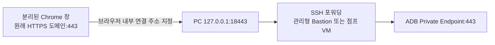

# ADB SQL Worksheet의 사설 HTTPS 접속

목표는 **원래 Worksheet URL을 유지하면서 ADB 사설 IP의 443 포트로 연결해 로그인 화면을 표시**하는 것입니다. 이번 접속 검증은 로그인·SQL 실행을 포함하지 않습니다.

## 구성



주소창·HTTP Host·TLS의 서버 이름은 원래 도메인을 유지합니다. 실제 TCP 연결만 로컬 터널로 보냅니다. 시스템 hosts 파일·DNS·기본 브라우저 설정은 바꾸지 않습니다. 인증서 검증도 유지합니다.

**DNS 확인:** 테스트에서 PC와 다른 VCN을 주 NIC로 사용하는 VM은 공용 IP를, **ADB와 같은 VCN의 점프 VM은 사설 IP를 반환**했습니다. SOCKS5의 원격 DNS는 해당 경유지의 DNS 결과를 사용하므로 경유 VCN이 중요합니다. SQL용 `oraclecloud.com`과 웹용 `oraclecloudapps.com`도 구분합니다. 도메인은 추측하지 말고 도구 설정의 **Private access URL**을 사용합니다. [ADB의 웹 도메인·DNS 설정](https://docs.oracle.com/en-us/iaas/autonomous-database-serverless/doc/private-endpoints-autonomous.html)

아래 고정 포워딩 방식은 DNS 결과와 관계없이 목적지 사설 IP를 명시합니다. SOCKS5를 사용할 경우에는 [원격 DNS 경로](#socks5-대안)를 확인합니다.

## 1. HTTPS 터널 준비

[Bastion 준비](bastion.md)를 완료하고 `config/managed-services.json`의 `adb-worksheet`에 실제 ADB 사설 IP를 입력합니다. 로컬 포트는 18443, 대상 포트는 443입니다.

```sh
OCI_ACCESS_CONFIG=config/managed-services.json sh scripts/workflow.sh plan adb-worksheet
OCI_ACCESS_CONFIG=config/managed-services.json sh scripts/workflow.sh connect adb-worksheet --execute
```

터널을 유지합니다. 관리형 Bastion의 사설 endpoint에서 ADB의 443에 도달할 수 있어야 합니다. 이 도구가 보안 규칙을 자동 추가하지 않습니다.

## 2. 원래 도메인으로 curl 확인

별도 터미널에서 실제 도구 URL로 바꿔 실행합니다.

```sh
WORKSHEET_URL='https://SERVICE.adb.REGION.oraclecloudapps.com/ords/sql-developer'
WORKSHEET_HOST='SERVICE.adb.REGION.oraclecloudapps.com'
curl --noproxy '*' --connect-timeout 5 --max-time 20 \
  --connect-to "$WORKSHEET_HOST:443:127.0.0.1:18443" \
  --output /dev/null --write-out 'HTTP=%{http_code} TLS=%{ssl_verify_result}\n' \
  "$WORKSHEET_URL"
```

`--connect-to`는 연결 위치만 변경합니다. URL·TLS 이름은 유지됩니다. 정상 로그인 페이지의 HTTP 200과 TLS 검증 결과 0을 확인합니다. HTTP 200만으로 페이지 내용이 정상이라고 확정하지 말고 다음 브라우저 검사도 수행합니다. [curl 연결 주소와 TLS 이름](https://curl.se/docs/manpage.html#--connect-to)

## 3. 분리된 Chrome·Chromium 창 열기

Chrome 또는 Chromium을 설치한 macOS·Linux에서 사용합니다. 먼저 명령을 미리 봅니다.

```sh
sh scripts/workflow.sh worksheet --url "$WORKSHEET_URL" --local-port 18443
sh scripts/workflow.sh worksheet --url "$WORKSHEET_URL" --local-port 18443 --execute
```

도우미는 임시 브라우저 프로파일을 만들고 **해당 호스트의 443만** `127.0.0.1:18443`으로 연결합니다. 다른 호스트는 매핑하지 않습니다. 별도 Chrome 창에 적용하는 `--no-proxy-server`는 그 창에서 시스템 프록시를 사용하지 않게 하므로, 조직의 프록시 사용 요건에 맞는 환경에서만 실행합니다. 회사의 기존 브라우저 설정을 덮어쓰지 않습니다. Linux에서 실행 파일을 찾지 못하면 `--browser /실제/경로/chromium`을 지정합니다.

주소창은 원래 `https://.../ords/sql-developer`이며 `localhost`나 `:18443`으로 바꾸지 않습니다. 리다이렉트 후에도 원래 443 주소를 사용할 수 있습니다. SSO 등 **다른 도메인으로 이동하는 기능은 이번 검증 범위 밖**입니다. 추가 사설 호스트가 필요한 서비스는 각각 경로·DNS를 확인해야 합니다.

브라우저의 호스트·포트 매핑은 Chromium의 [공식 테스트 예제](https://chromium.googlesource.com/website/+/refs/heads/main/site/quic/playing-with-quic/index.md)에 설명된 기능입니다. 인증서 무시·웹 보안 해제 옵션은 사용하지 않습니다.

## 검증 기준과 종료

- 주소창에 원래 HTTPS 도메인 표시, 인증서 오류 없음.
- Worksheet 로그인 화면과 사용자명·비밀번호 입력란 정상 표시.
- 개발자 도구 Network에서 필요한 JS·CSS 등의 실패 확인. HTTP 오류·콘솔 오류와 리다이렉트 확인.
- 로그인·SQL 실행을 시험하지 않았다면 **사설 HTTPS 페이지 접근 성공**으로만 기록.
- 전용 브라우저를 완전히 종료하고 터널을 `Ctrl+C`로 종료. 도우미가 실행한 브라우저 프로세스 종료 후 임시 프로파일을 정리합니다. OCI 세션도 별도 정리합니다.

## 실제 확인 범위

2026-11-23, 기존 **점프 VM**의 OpenSSH로 두 경로를 확인했습니다.

| 경로 | 결과 |
|---|---|
| 고정 443 포워딩 + Chrome 호스트·포트 매핑 | curl HTTP 200·TLS 검증 성공, 로그인 화면 정상, 리소스 15건 오류 없음 |
| SOCKS5 + 같은 VCN의 원격 DNS | 사설 IP 해석, curl HTTP 200·TLS 검증 성공, Chrome 로그인 화면·리소스 15건 오류 없음 |

Chrome 157.0.8103.80의 분리된 headless 세션으로 확인했습니다. 로그인 정보는 입력하지 않았으며 테스트 DB는 원래 중지 상태로 복구했습니다.

**OCI 관리형 Bastion·Tailscale·sshuttle 경유의 같은 화면 접속은 이번 시험에서 검증하지 않았습니다.** 이번 결과는 기존 점프 VM의 고정·동적 SSH 터널에 대한 검증입니다. [전체 검증 범위](../validation.md)

## SOCKS5 대안

경유지가 ADB와 같은 VCN에 있고 Worksheet 도메인을 사설 IP로 해석한다면, 목적지별 고정 포워딩 없이 원래 URL을 사용할 수 있습니다.

1. 경유 VM에서 해당 웹 FQDN의 DNS 결과가 ADB 사설 IP인지 확인합니다. `getent ahostsv4` 또는 해당 OS의 resolver 조회를 사용합니다.
2. 기존 점프 VM은 `ssh -N -D 127.0.0.1:1080 USER@JUMP_HOST`로 실행합니다. 관리형 Bastion은 `managed-socks` target을 사용하되 별도 서비스 준비가 필요합니다.
3. 브라우저에 SOCKS5 `127.0.0.1:1080`과 **프록시를 통한 DNS 조회**를 설정하고 원래 Worksheet URL을 엽니다. [설정·복구](socks5-walkthrough.md)

curl에서는 원격 DNS를 사용하는 `socks5h`로 확인합니다. 이 경우 사설 IP를 별도로 지정하지 않습니다.

```sh
curl --noproxy '' --proxy socks5h://127.0.0.1:1080 \
  --connect-timeout 5 --max-time 20 --output /dev/null \
  --write-out 'HTTP=%{http_code} TLS=%{ssl_verify_result}\n' "$WORKSHEET_URL"
```

공용 IP가 반환된다면 올바른 VCN의 경유지를 선택하거나 사설 DNS를 구성합니다. **다른 VCN으로 향하는 NIC가 추가됐다는 사실만으로 기본 DNS·라우트가 바뀌지는 않습니다.** 겹치는 IP 대역과 다중 NIC도 확인합니다.
