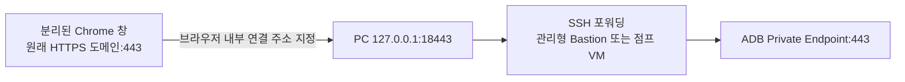

# ADB SQL Worksheet의 사설 HTTPS 접속

목표는 **원래 Worksheet URL을 유지하면서 ADB 사설 IP의 443 포트로 연결해 로그인 화면을 표시**하는 것입니다. 이번 접속 검증은 로그인·SQL 실행을 포함하지 않습니다.

## 구성



주소창·HTTP Host·TLS의 서버 이름은 원래 도메인을 유지합니다. 실제 TCP 연결만 로컬 터널로 보냅니다. 시스템 hosts 파일·DNS·기본 브라우저 설정은 바꾸지 않습니다. 인증서 검증도 유지합니다.

**DNS 확인:** 테스트에서 PC와 다른 VCN을 주 NIC로 사용하는 VM은 공용 IP를, **ADB와 같은 VCN의 점프 VM은 사설 IP를 반환**했습니다. SOCKS5의 원격 DNS는 해당 경유지의 DNS 결과를 사용하므로 경유 VCN이 중요합니다. SQL용 `oraclecloud.com`과 웹용 `oraclecloudapps.com`도 구분합니다. 도메인은 추측하지 말고 도구 설정의 **Private access URL**을 사용합니다. [ADB의 웹 도메인·DNS 설정](https://docs.oracle.com/en-us/iaas/autonomous-database-serverless/doc/private-endpoints-autonomous.html)

아래 고정 포워딩 방식은 DNS 결과와 관계없이 목적지 사설 IP를 명시합니다. SOCKS5를 사용할 경우에는 [원격 DNS 경로](#socks5-대안)를 확인합니다.

## DNS와 라우팅이 처리되는 위치

**DNS는 목적지 IP를 찾고, 라우팅은 그 IP로 가는 경로를 결정합니다.** PC가 Worksheet 도메인을 ADB 사설 IP로 해석하더라도, VPN 등으로 그 사설망에 도달하지 못하면 접속할 수 없습니다. hosts 파일에 사설 IP만 등록해도 경로는 생기지 않습니다.

SSH 터널에서는 **PC가 ADB 사설 IP에 직접 연결하지 않습니다. PC는 SSH 경유지에 연결하고, 경유지가 ADB에 연결합니다.** 아래 도메인·IP는 원리를 설명하는 예시이며 실제 서비스 주소가 아닙니다.

### 고정 포워딩: 브라우저의 연결 주소를 로컬 포트로 지정

점프 VM을 이용하는 OpenSSH 예시는 다음과 같습니다. 관리형 Bastion의 실제 실행은 아래 [HTTPS 터널 준비](#1-https-터널-준비)의 도우미를 사용합니다.

```sh
ssh -N -L 127.0.0.1:18443:10.20.1.20:443 opc@JUMP_HOST
```

이 명령은 PC의 `18443`으로 들어온 연결을 SSH로 전달하고, 점프 VM에서 `10.20.1.20:443`으로 새 연결을 만들게 합니다. **터널을 열기만 하면 원래 도메인의 브라우저 요청이 자동으로 터널을 타는 것은 아닙니다.** `worksheet` 도우미는 분리된 Chrome 창에 다음 설정을 추가합니다.

```text
--host-resolver-rules="MAP worksheet.example.com:443 127.0.0.1:18443"
```

```text
주소창: https://worksheet.example.com/ords/sql-developer
    ↓ Chrome의 해당 도메인 연결 주소 매핑
PC의 127.0.0.1:18443 → 로컬 SSH 프로그램
    ↓ 이미 연결된 SSH 통신으로 데이터 전달
점프 VM → 새 TCP 연결 → ADB 사설 IP 10.20.1.20:443
```

| 실제 연결 구간 | 사용 경로 |
|---|---|
| Chrome → 127.0.0.1:18443 | PC 내부 루프백 |
| PC의 SSH → 점프 VM | PC의 기존 네트워크를 통한 SSH 접속 경로 |
| 점프 VM → ADB 사설 IP:443 | 점프 VM과 VCN의 사설 경로 |

PC의 OS 라우팅 테이블에 ADB 대역을 추가하지 않습니다. Chrome이 이 호스트의 연결 주소를 로컬 포트로 지정하므로, 이 고정 방식에서는 ADB 도메인의 일반 DNS 조회 결과에 의존하지 않습니다. SSH 설정의 목적지 사설 IP가 정확해야 하며, 그 IP까지의 경로는 경유지에 있어야 합니다.

### HTTPS: 연결 주소와 서비스 이름을 분리

| 항목 | 유지하거나 변경하는 값 |
|---|---|
| 주소창·HTTP 서비스 호스트 이름 | 원래 Worksheet 도메인 유지 |
| TLS에서 요청하는 서버 이름(SNI)·인증서 이름 확인 | 원래 Worksheet 도메인 유지 |
| Chrome의 실제 TCP 연결 목적지 | 127.0.0.1:18443으로 변경 |
| SSH 경유지가 연결하는 목적지 | ADB 사설 IP:443 |

브라우저와 ADB 사이의 TLS 데이터는 SSH가 그대로 전달합니다. 점프 VM에서 HTTPS를 해독하거나 인증서를 교체하지 않습니다. 주소창을 `https://localhost:18443`으로 바꾸면 서비스 이름도 localhost로 바뀌므로 이 구성과 다릅니다. curl의 `--connect-to`도 연결 주소만 바꾸고 TLS 이름은 유지합니다. [공식 동작](https://curl.se/libcurl/c/CURLOPT_CONNECT_TO.html)

### SOCKS5: 도메인 조회와 목적지 연결을 경유지에 요청

고정 포워딩이 목적지 IP·포트를 미리 지정하는 것이라면, SOCKS5는 브라우저가 요청마다 목적지를 전달하는 방식입니다. 점프 VM에 대한 `ssh -D 127.0.0.1:1080`과 브라우저의 SOCKS5·원격 DNS 설정을 사용하면 다음과 같이 동작합니다.

```text
브라우저 → PC의 SOCKS5 127.0.0.1:1080
           요청: worksheet.example.com:443에 연결
    ↓ SSH로 요청 전달
점프 VM의 DNS: worksheet.example.com → ADB 사설 IP
    ↓ 점프 VM의 네트워크 경로로 연결
ADB 사설 IP:443
```

PC는 로컬 SOCKS5에 연결하고, 도메인 조회와 ADB 연결은 경유지에서 처리합니다. 브라우저의 접속용 DNS를 경유지에서 처리하도록 설정해야 합니다. Chrome의 SOCKS5는 프록시 측 조회를 사용하고, Firefox는 원격 DNS 옵션을 확인합니다. [Chromium 공식 설명](https://github.com/chromium/chromium/blob/main/net/docs/proxy.md)

경유지 DNS가 공용 IP를 반환하면 공용 주소로 연결을 시도하므로, **도메인이 경유지에서 ADB 사설 IP로 해석되는지** 확인합니다. SOCKS5를 설정해도 경유지에 없는 사설 경로가 만들어지지는 않습니다.

| 방식 | ADB 연결 주소 결정 | ADB에 연결하는 곳 | PC에 ADB 사설망 경로 필요 |
|---|---|---|---|
| 고정 포워딩 + Chrome 매핑 | SSH 설정에 사설 IP 지정 | SSH 경유지 | 불필요 |
| SOCKS5 + 원격 DNS | 경유지의 DNS 조회 | SSH 경유지 | 불필요 |
| VPN 직접 접속 | PC의 DNS 조회 | PC | 필요 |

두 터널 방식 모두 경유지에서 ADB까지의 경로·443 보안 규칙이 필요합니다. 점프 VM 시험에서는 해당 VM의 사설 IP를, 관리형 Bastion 구성에서는 Bastion 사설 엔드포인트 IP를 허용 출발지로 검토합니다. **경유지 → ADB Private Endpoint 구간에는 IGW·NAT가 필요하지 않습니다.** PC → 경유지의 관리 접속 경로는 별도로 필요합니다.

Chrome 고정 매핑은 지정한 호스트의 443에만 적용합니다. 다른 도메인의 사설 리소스나 SSO로 이동하면 해당 목적지의 DNS·경로·인증을 별도로 확인합니다. 아래 실제 검증은 기존 점프 VM의 로그인 화면·리소스 로딩까지이며, 관리형 Bastion·VPN·SSO 성공을 의미하지 않습니다.

## 1. HTTPS 터널 준비

[Bastion 준비](bastion.md)를 완료하고 `config/managed-services.json`의 `adb-worksheet`에 실제 ADB 사설 IP를 입력합니다. 로컬 포트는 18443, 대상 포트는 443입니다.

```sh
OCI_ACCESS_CONFIG=config/managed-services.json sh scripts/workflow.sh plan adb-worksheet
OCI_ACCESS_CONFIG=config/managed-services.json sh scripts/workflow.sh connect adb-worksheet --execute
```

터널을 유지합니다. 관리형 Bastion의 사설 endpoint에서 ADB의 443에 도달할 수 있어야 합니다. 이 도구가 보안 규칙을 자동 추가하지 않습니다.

## 2. 원래 도메인으로 curl 확인

별도 터미널에서 실제 도구 URL로 바꿔 실행합니다.

```sh
WORKSHEET_URL='https://SERVICE.adb.REGION.oraclecloudapps.com/ords/sql-developer'
WORKSHEET_HOST='SERVICE.adb.REGION.oraclecloudapps.com'
curl --noproxy '*' --connect-timeout 5 --max-time 20 \
  --connect-to "$WORKSHEET_HOST:443:127.0.0.1:18443" \
  --output /dev/null --write-out 'HTTP=%{http_code} TLS=%{ssl_verify_result}\n' \
  "$WORKSHEET_URL"
```

`--connect-to`는 연결 위치만 변경합니다. URL·TLS 이름은 유지됩니다. 정상 로그인 페이지의 HTTP 200과 TLS 검증 결과 0을 확인합니다. HTTP 200만으로 페이지 내용이 정상이라고 확정하지 말고 다음 브라우저 검사도 수행합니다. [curl 연결 주소와 TLS 이름](https://curl.se/docs/manpage.html#--connect-to)

## 3. 분리된 Chrome·Chromium 창 열기

Chrome 또는 Chromium을 설치한 macOS·Linux에서 사용합니다. 먼저 명령을 미리 봅니다.

```sh
sh scripts/workflow.sh worksheet --url "$WORKSHEET_URL" --local-port 18443
sh scripts/workflow.sh worksheet --url "$WORKSHEET_URL" --local-port 18443 --execute
```

도우미는 임시 브라우저 프로파일을 만들고 **해당 호스트의 443만** `127.0.0.1:18443`으로 연결합니다. 다른 호스트는 매핑하지 않습니다. 별도 Chrome 창에 적용하는 `--no-proxy-server`는 그 창에서 시스템 프록시를 사용하지 않게 하므로, 조직의 프록시 사용 요건에 맞는 환경에서만 실행합니다. 회사의 기존 브라우저 설정을 덮어쓰지 않습니다. Linux에서 실행 파일을 찾지 못하면 `--browser /실제/경로/chromium`을 지정합니다.

주소창은 원래 `https://.../ords/sql-developer`이며 `localhost`나 `:18443`으로 바꾸지 않습니다. 리다이렉트 후에도 원래 443 주소를 사용할 수 있습니다. SSO 등 **다른 도메인으로 이동하는 기능은 이번 검증 범위 밖**입니다. 추가 사설 호스트가 필요한 서비스는 각각 경로·DNS를 확인해야 합니다.

브라우저의 호스트·포트 매핑은 Chromium의 [공식 테스트 예제](https://chromium.googlesource.com/website/+/refs/heads/main/site/quic/playing-with-quic/index.md)에 설명된 기능입니다. 인증서 무시·웹 보안 해제 옵션은 사용하지 않습니다.

## 검증 기준과 종료

- 주소창에 원래 HTTPS 도메인 표시, 인증서 오류 없음.
- Worksheet 로그인 화면과 사용자명·비밀번호 입력란 정상 표시.
- 개발자 도구 Network에서 필요한 JS·CSS 등의 실패 확인. HTTP 오류·콘솔 오류와 리다이렉트 확인.
- 로그인·SQL 실행을 시험하지 않았다면 **사설 HTTPS 페이지 접근 성공**으로만 기록.
- 전용 브라우저를 완전히 종료하고 터널을 `Ctrl+C`로 종료. 도우미가 실행한 브라우저 프로세스 종료 후 임시 프로파일을 정리합니다. OCI 세션도 별도 정리합니다.

## 실제 확인 범위

2026-11-23, 기존 **점프 VM**의 OpenSSH로 두 경로를 확인했습니다.

| 경로 | 결과 |
|---|---|
| 고정 443 포워딩 + Chrome 호스트·포트 매핑 | curl HTTP 200·TLS 검증 성공, 로그인 화면 정상, 리소스 15건 오류 없음 |
| SOCKS5 + 같은 VCN의 원격 DNS | 사설 IP 해석, curl HTTP 200·TLS 검증 성공, Chrome 로그인 화면·리소스 15건 오류 없음 |

Chrome 157.0.8103.80의 분리된 headless 세션으로 확인했습니다. 로그인 정보는 입력하지 않았으며 테스트 DB는 원래 중지 상태로 복구했습니다.

**OCI 관리형 Bastion·Tailscale·sshuttle 경유의 같은 화면 접속은 이번 시험에서 검증하지 않았습니다.** 이번 결과는 기존 점프 VM의 고정·동적 SSH 터널에 대한 검증입니다. [전체 검증 범위](../validation.md)

## SOCKS5 대안

경유지가 ADB와 같은 VCN에 있고 Worksheet 도메인을 사설 IP로 해석한다면, 목적지별 고정 포워딩 없이 원래 URL을 사용할 수 있습니다.

1. 경유 VM에서 해당 웹 FQDN의 DNS 결과가 ADB 사설 IP인지 확인합니다. `getent ahostsv4` 또는 해당 OS의 resolver 조회를 사용합니다.
2. 기존 점프 VM은 `ssh -N -D 127.0.0.1:1080 USER@JUMP_HOST`로 실행합니다. 관리형 Bastion은 `managed-socks` target을 사용하되 별도 서비스 준비가 필요합니다.
3. 브라우저에 SOCKS5 `127.0.0.1:1080`과 **프록시를 통한 DNS 조회**를 설정하고 원래 Worksheet URL을 엽니다. [설정·복구](socks5-walkthrough.md)

curl에서는 원격 DNS를 사용하는 `socks5h`로 확인합니다. 이 경우 사설 IP를 별도로 지정하지 않습니다.

```sh
curl --noproxy '' --proxy socks5h://127.0.0.1:1080 \
  --connect-timeout 5 --max-time 20 --output /dev/null \
  --write-out 'HTTP=%{http_code} TLS=%{ssl_verify_result}\n' "$WORKSHEET_URL"
```

공용 IP가 반환된다면 올바른 VCN의 경유지를 선택하거나 사설 DNS를 구성합니다. **다른 VCN으로 향하는 NIC가 추가됐다는 사실만으로 기본 DNS·라우트가 바뀌지는 않습니다.** 겹치는 IP 대역과 다중 NIC도 확인합니다.
